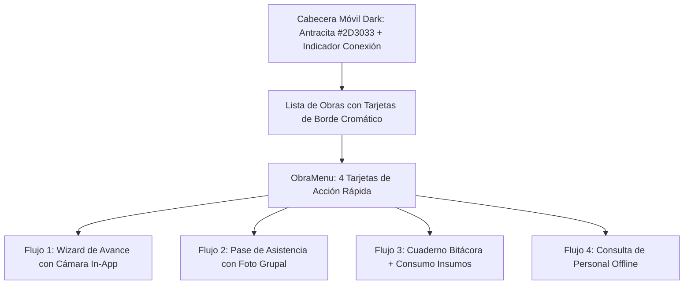

# 🎨 Guía de Diseño UI/UX y Sistema de Interfaz: Ecosistema Trabs

**Organización**: Accuratek  
**Fecha de Actualización**: Agosto 2026  
**Ecosistema**: Trabs (Trabs Gerencia + Trabs Terreno)  
**Documento**: Design System Oficial Trabs 2026, Tokens de Diseño, Tipografía, Especificación de Componentes y Principios UX

---

## 🏛️ 1. Filosofía de Diseño y Principios UX

El ecosistema **Trabs** está diseñado para resolver la brecha entre el trabajo rudo e intensivo en el frente de faena y la toma de decisiones ejecutivas en la administración central. Se rige por 4 pilares esenciales:

1. **Estética Executive & Industrial Robust**: Combinación de alto contraste entre superficies oscuras en *Antracita Oscuro* (`#2D3033`), acentos dinámicos en *Ámbar Solar* (`#F3A500`) y áreas de trabajo en *Gris Hielo Clean* (`#F4F6F8`), garantizando claridad bajo luz solar directa en terreno o pantallas de oficina.
2. **Zero-Freeze UX (Rendimiento Asíncrono Nativo)**: Ninguna llamada a Supabase PostgreSQL, subida de fotografías a Storage o renderizado de PDFs bloquea la interfaz de usuario. Todo proceso de entrada/salida corre en subprocesos `QThread` (escritorio) o tareas asíncronas optimizadas con ArrayBuffer (móvil).
3. **Diseño Offline-First Transparente**: La interfaz móvil responde de manera instantánea y optimista, almacenando los datos en SQLite local (`accuraop.db`) y mostrando indicadores visuales claros sobre el estado de sincronización.
4. **Prevención Activa de Errores Humanos**: Uso de asistentes guiados paso a paso (*wizards*) para la ingesta de presupuestos, toma de asistencia y emisión inmutable de Estados de Pago (EDP), requiriendo confirmaciones explícitas antes de acciones irreversibles.

---

## 🎨 2. Design Tokens y Paleta de Colores Curada (Trabs 2026)

La paleta cromática está unificada en la hoja de estilos Qt [`accuraop_gerencia/src/ui/style.qss`](file:///C:/Users/fcola/Desktop/APPACCURATEK/accuraop_gerencia/src/ui/style.qss) y en las constantes móviles [`accuraop_terreno/src/constants/theme.js`](file:///C:/Users/fcola/Desktop/APPACCURATEK/accuraop_terreno/src/constants/theme.js).

| Rol en el Sistema | Nombre del Token | Código HEX | Uso en Escritorio (`PyQt6`) | Uso en Móvil (`React Native`) |
| :--- | :--- | :--- | :--- | :--- |
| **Primario / CTA / Acento** | Ámbar Solar | `#F3A500` | Botones de acción principales, bordes de foco, acento en pestañas activas y barra inferior de encabezados de tabla. | Botones de confirmación, selector de pasos activos y acentos de marca. |
| **Superficie Oscura / Header** | Antracita Oscuro | `#2D3033` | Fondo de la Barra Lateral fija (`#Sidebar`), encabezados de tablas (`QHeaderView`) y títulos destacados. | Encabezado superior (*Header*), barra de estado y tarjetas dark. |
| **Gris Neutro / Bordes** | Gris Acero | `#808A92` | Bordes de inputs, líneas de división de tablas, etiquetas de subtítulo y botones deshabilitados. | Bordes de contenedores, divisores y textos secundarios. |
| **Superficie Secundaria** | Carbón Pizarra | `#414445` | Separadores oscuros y botones activos del sidebar (`:checked`). | Fondos secundarios y divisores dark. |
| **Acento Neutro** | Pizarra Medio | `#4A5156` | Pestañas inactivas, iconografía de apoyo y textos complementarios. | Iconos secundarios y etiquetas descriptivas. |
| **Fondo Principal de Trabajo** | Gris Hielo Clean | `#F4F6F8` | Fondo de la ventana principal (`QMainWindow`), stack de vistas y áreas con scroll. | Fondo principal de todas las pantallas (`COLORS.background`). |
| **Superficie de Tarjetas** | Blanco Puro | `#FFFFFF` | Fondo de tarjetas KPI, diálogos modales (`QDialog`), filas de tabla e inputs. | Tarjetas de obra, modales y formularios. |
| **Texto Principal** | Oscuro Elegante | `#1F2115` | Títulos principales, cuerpo de tablas e inputs para máxima legibilidad. | Títulos de sección, nombres de faena y textos clave. |
| **Estado Éxito / Sincronizado** | Verde Esmeralda | `#10B981` | Insignias de obras activas, avances aprobados y KPIs de producción. | Indicador de sincronización completada y presentismo (1.0). |
| **Estado Alerta / Peligro** | Rojo Alerta | `#EF4444` / `#DC2626` | Obras pausadas, avances rechazados, botón de cerrar sesión y errores de red. | Indicador sin conexión (*offline*), ausencias (0.0) y alertas. |
| **Estado Pendiente / Revisión**| Ámbar Solar | `#F3A500` | Avances en revisión, montos pendientes de cobro y registros por facturar. | Registros pendientes de sincronización y medio día (0.5). |

---

## 🔤 3. Tipografía y Jerarquía Visual

El sistema utiliza dos familias tipográficas de Google Fonts:

1. **Montserrat (Títulos, Headings y Valores KPI)**:
   * `Montserrat-Bold` (700/800) y `Montserrat-SemiBold` (600).
   * Utilizada en títulos principales (`#TitleLabel`, 22px-24px), encabezados modales y los valores numéricos destacados de las tarjetas KPI (26px-28px).
   * Otorga una presencia corporativa, ejecutiva y estructurada.
2. **Inter (Cuerpo de Texto, Tablas, Inputs y Metadatos)**:
   * `Inter-Regular` (400), `Inter-Medium` (500) e `Inter-Bold` (700).
   * Utilizada en formularios, celdas de tablas (13px-14px), subtítulos, badges y descripciones técnicas.
   * Diseñada para legibilidad óptima en interfaces de alta densidad de datos.

---

## 🖥️ 4. Especificación de Componentes UI: Aplicación de Escritorio (`accuraop_gerencia`)

### 4.1 Barra Lateral de Navegación (`#Sidebar`)
* **Dimensiones y Elevación**: Ancho fijo de 250px con `QGraphicsDropShadowEffect` (blur: 15px, offset X: 2px, color: `rgba(0,0,0,40)`).
* **Identidad de Marca**: Logotipo oficial Trabs (`logo_trabs_nombre_sf.png`) centrado y escalado a 180px de ancho.
* **Botones de Navegación (`.SidebarButton`)**:
  * Estado normal: Texto en `#EAECEE`, fondo transparente.
  * Estado hover: Fondo `rgba(255, 255, 255, 0.12)`, texto blanco puro.
  * Estado activo (`:checked`): Fondo `#414445`, borde izquierdo acentuado `border-left: 4px solid #F3A500`, texto en negrita.
* **Acciones Inferiores**:
  * Botón Resincronizar (`.SidebarButtonSync`): Borde y texto en Ámbar Solar (`#F3A500`), hover en `rgba(243, 165, 0, 0.15)`.
  * Botón Cerrar Sesión (`.SidebarButtonLogout`): Borde y texto en Rojo Alerta (`#EF4444`), hover en `rgba(239, 68, 68, 0.2)`.

### 4.2 Tarjetas de Obra y KPIs (`ClickableObraCard` & `.Card`)
* **Estructura Visual**: Fondo Blanco Puro (`#FFFFFF`), bordes redondeados (`border-radius: 12px`) y sombra flotante `QGraphicsDropShadowEffect` (blur: 15px, offset Y: 4px).
* **Franja Temática de Faena**: `border-left: 8px solid {color_hex}`, permitiendo reconocer instantáneamente la obra por su color institucional asignado en la ingesta.
* **Indicadores Pulsantes**: Punto de estado `●` en Verde Esmeralda (`#10B981`) para faenas activas o Rojo Alerta (`#EF4444`) para faenas pausadas.

### 4.3 Tablas de Datos de Alta Densidad (`QTableWidget` / `QTableView`)
* **Espaciado y Altura de Fila**: Filas con altura mínima de 44px (`min-height: 44px`) y acolchado de celda (`padding: 12px 14px`).
* **Encabezados (`QHeaderView::section`)**: Fondo en Antracita Oscuro (`#2D3033`), texto en mayúsculas pequeñas (12px, negrita, `#FFFFFF`) y borde inferior en Ámbar Solar de 2px (`border-bottom: 2px solid #F3A500`).
* **Alternancia de Filas**: Filas pares en `#FFFFFF` y filas impares en Slate-50 suave (`#F8FAFC`).
* **Selección de Fila**: Fondo en Antracita `#2D3033` con texto en blanco para evitar contrastes deficientes.

### 4.4 Paneles y Pestañas (`QTabWidget` & `QTabBar`)
* Pestañas con bordes superiores redondeados (`border-top-left-radius: 6px`, `border-top-right-radius: 6px`).
* Pestaña inactiva: Fondo `#EAECEE`, texto `#4A5156`.
* Pestaña activa: Fondo `#FFFFFF`, texto `#2D3033`, borde inferior en Ámbar Solar de 3px (`border-bottom: 3px solid #F3A500`).

### 4.5 Diálogos Asistentes y Modales (`QDialog`)
* Modales estructurados en pasos para procesos sensibles:
  * `CrearMaterialesNuevosDialog`: Asistente para dar de alta insumos faltantes durante la ingesta.
  * `PreciosMaterialesDialog`: Diálogo para fijar precios unitarios de contrato.
  * `EmisionEDPDialog`: Asistente financiero para emisión de Estados de Pago con confirmación de congelamiento.

---

## 📱 5. Especificación de Componentes UI: Aplicación Móvil (`accuraop_terreno`)

### 5.1 Cabecera Superior Móvil
* Fondo en Antracita Oscuro (`#2D3033`) con texto en blanco puro.
* Botón de retroceso táctil amplio (`‹ Volver`) con fondo translúcido (`rgba(255,255,255,0.15)`).
* Badge visual de conectividad en tiempo real (Punto verde / ámbar / rojo).

### 5.2 Hub de Acceso Rápido (`ObraMenuScreen.js`)
* Despliegue en cuadrícula de 4 grandes tarjetas táctiles optimizadas para uso con guantes o en terreno:
  1. **Registrar Avance**: Icono de estructura, acento Ámbar.
  2. **Asistencia Diaria**: Icono de lista/personal, acento Azul Acero.
  3. **Bitácora y Consumos**: Icono de cuaderno/cámara, acento Pizarra.
  4. **Control de Obra**: Icono de credencial/nómina, acento Ámbar.

### 5.3 Selectores de Asistencia (`AsistenciaScreen.js`)
* Segmentos de selección rápida por trabajador con respuesta táctil instantánea:
  * Botón **Presente (1.0)**: Borde y fondo en Verde Esmeralda (`#10B981`).
  * Botón **Medio Día (0.5)**: Borde y fondo en Ámbar Solar (`#F3A500`).
  * Botón **Ausente (0.0)**: Borde y fondo en Gris Neutro (`#808A92`).

### 5.4 Notificaciones Toast Personalizadas (`react-native-toast-message`)
* Componente flotante superior con elevación y borde izquierdo coloreado según el tipo:
  * **Éxito**: Borde izquierdo verde, icono `listo_logo.png`, mensaje de sincronización completa.
  * **Error**: Borde izquierdo rojo, icono `error_logo.png`, mensaje de fallo o reintento.
  * **Info**: Borde izquierdo ámbar, aviso de conectividad offline.

---

## ⚡ 6. Patrones de Feedback y Prevención de Errores

1. **Estado Visual Deshabilitado en Botones**: Al presionar cualquier acción asíncrona de guardado o sincronización, el botón se deshabilita de inmediato y conmuta su texto (`"Procesando..."`, `"Cargando..."`, `"Sincronizando..."`).
2. **Confirmaciones Explícitas Previas a Acciones Irreversibles**:
   * Congelar partidas en un Estado de Pago (`QMessageBox.question`).
   * Cerrar sesión activa.
3. **Resaltado de Errores y Validaciones**: Inputs con validación en foco con borde ámbar de 2px (`border: 2px solid #F3A500`) y mensajes de error estilizados en rojo `#DC2626`.
