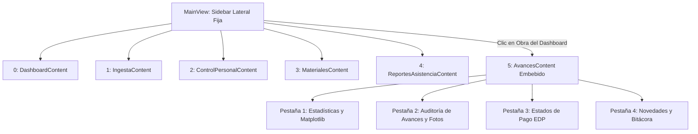

# 🖥️ Contexto Técnico de la Aplicación de Escritorio: Trabs Gerencia (`accuraop_gerencia`)

**Organización**: Accuratek  
**Fecha de Actualización**: Agosto 2026  
**Módulo**: Suite de Escritorio Administrativa y Financiera (`accuraop_gerencia`)  
**Versión de Producción**: 1.0.0 (Instalador Oficial: `TrabsGerencia_Setup_v1.0.0.exe`)  
**Documento**: Guía Técnica Integral de Arquitectura, Concurrencia, Controladores, Módulos UI y Distribución

---

## 🛠️ 1. Stack Tecnológico y Dependencias

* **Lenguaje de Programación**: Python 3.10+
* **Framework de Interfaz Gráfica**: **PyQt6** (Arquitectura nativa de alto rendimiento con widgets personalizados, estilos QSS y efectos de sombra `QGraphicsDropShadowEffect`).
* **Visualización y Gráficos Analíticos**: **Matplotlib** (`FigureCanvasQTAgg` y `Figure` embebidos directamente en paneles de Qt).
* **Compilación de Documentos Oficiales (PDF)**: **ReportLab** (Maquetación vectorial de Estados de Pago con logotipos, desgloses matriciales y cajas de firma formal).
* **Ingesta y Procesamiento de Datos**: **Pandas** y **openpyxl** (Lectura, limpieza, filtrado y tipado estricto de matrices Excel de cubicación técnica).
* **Conectividad a la Nube**: **supabase-py** (Cliente oficial para Supabase Auth, base de datos relacional PostgreSQL y buckets S3 Storage).
* **Empaquetado y Distribución**:
  * **PyInstaller** (`gerencia.spec` & `build_exe.py`): Compilación en modo carpeta autocontenida (`onedir`) con resolución estática de librerías C++ y assets.
  * **Inno Setup** (`TrabsGerencia_Setup.iss`): Generador de instalador ejecutable para Windows con integración de iconos de escritorio, menú inicio y registro.

---

## 📂 2. Estructura de Directorios Completa

```text
accuraop_gerencia/
├── main.py                          # Punto de entrada, inicialización de QApplication, verificación de sesión y arranque
├── requirements.txt                 # Especificación de dependencias fijadas
├── build_exe.py                     # Script de automatización de compilación con PyInstaller
├── gerencia.spec                    # Archivo de configuración técnica de empaquetado PyInstaller
├── TrabsGerencia_Setup.iss          # Script de compilación de instalador oficial para Inno Setup
├── create-jefe-obra.js              # Script helper en Node.js para registro administrativo de supervisores en Supabase Auth
├── test_controller.py               # Suite de pruebas unitarias para controladores
├── assets/                          # Recursos gráficos institucionales, logotipos y fuentes
│   ├── app_icon.ico                 # Icono oficial de la aplicación de escritorio
│   ├── logo_trabs_nombre_sf.png     # Logo Trabs con texto sin fondo (Sidebar)
│   ├── logo_trabs_circular_sf.png   # Logo circular Trabs
│   ├── logo_trabs_solo_sf.png       # Isotipo Trabs
│   ├── animacion_trabs.gif          # Loader animado
│   └── *.png                        # Sprites e iconos de estados y reportes
├── dist_installer/                  # Binarios de distribución final compilados
│   └── TrabsGerencia_Setup_v1.0.0.exe # Instalador ejecutable oficial para Windows
├── documentos_edp/                  # Directorio local de respaldo para PDFs de Estados de Pago generados
└── src/
    ├── core/
    │   ├── controller.py            # Controlador de Ingesta Excel (IngestaController) y diálogo de precios
    │   ├── data_manager.py          # DataManager Singleton (Caché TTL en memoria y ejecución segura thread-safe)
    │   ├── edp_controller.py        # Controlador de Estados de Pago (EDPController): cálculos, folios y congelamiento
    │   ├── jefes_controller.py      # Controlador CRUD para la administración de Supervisores de Obra
    │   └── workers.py               # Colección de 35 hilos asíncronos (QThread) para el patrón Zero-Freeze
    ├── ui/
    │   ├── style.qss                # Hoja de estilos Qt oficial (Design System Trabs 2026)
    │   ├── login_screen.py          # Pantalla de autenticación con validación de rol administrativo
    │   ├── main_view.py             # Ventana principal: Sidebar Antracita + QStackedWidget conmutador
    │   ├── dashboard_view.py        # Dashboard general: KPIs, widget Asistencia Hoy y cuadrícula de obras
    │   ├── ingesta_view.py          # Vista asistida de importación y mapeo de planillas Excel de cubicación
    │   ├── jefes_view.py            # Vista modal/pestaña para gestión y asignación de Supervisores de Obra
    │   ├── avances_window.py        # Sub-vista de obra embebida (AvancesContent) con 4 pestañas operativas
    │   ├── control_personal_view.py # Vista de administración de cargos (tipos_maestro), maestros y asignación a faenas
    │   ├── reportes_asistencia_view.py # Vista de auditoría e historial de asistencia diaria con visor de fotos
    │   ├── materiales_view.py       # Catálogo maestro de insumos, unidades y rendimientos teóricos
    │   ├── edp_tab.py               # Pestaña de Estados de Pago, historial, KPIs y diálogo de emisión oficial
    │   ├── reportes_view.py         # Visor y módulo de respuesta a bitácoras de campo y novedades
    │   └── document_viewer.py       # Visor integrado de PDFs y planos técnicos
    └── utils/
        └── pdf_edp_generator.py     # Motor ReportLab de maquetación vectorial para PDFs oficiales de EDP
```

---

## ⚡ 3. Concurrencia y Capa de Datos Asíncrona (`core/`)

Para asegurar que la interfaz de usuario nunca sufra congelamientos (*Zero-Freeze UX*), todas las operaciones I/O hacia Supabase PostgreSQL o Storage se ejecutan en subprocesos `QThread` comunicados con la interfaz mediante señales de Qt (`pyqtSignal`).

### 3.1 DataManager Singleton (`src/core/data_manager.py`)
El módulo `DataManager` centraliza el estado en memoria y optimiza el consumo de red:
* **Patrón Singleton con Bloqueo de Hilo**: Garantiza una única instancia accesible desde cualquier vista o controlador.
* **Caché TTL (5 minutos)**: Mantiene en memoria las consultas de catálogo (obras, supervisores, materiales, cargos y maestros) evitando consultas redundantes.
* **Tolerancia a Fallos de Socket en Windows (`_safe_execute`)**: Captura excepciones de socket no bloqueante (`WSAEWOULDBLOCK` / código de error `10035`), aplicando un mecanismo de reintento automático (*retry con backoff*) de hasta 3 intentos antes de propagar fallos.
* **Pull Inicial por Lotes (`fetch_initial_batch`)**: Ejecuta una sincronización estructurada al iniciar la sesión o al presionar el botón `"🔄 Resincronizar Datos"`, emitiendo porcentajes de avance a la barra de estado.

### 3.2 Catálogo de Workers Asíncronos (`src/core/workers.py`)
La aplicación cuenta con **35 workers especializados**:

| Categoría | Workers Implementados | Función Principal |
| :--- | :--- | :--- |
| **Autenticación** | `LoginWorker`<br>`SessionCheckWorker`<br>`LogoutWorker` | Autentica vía Supabase Auth, valida en base de datos que el usuario no tenga rol `'jefe_obra'` (restringido a móviles) y cierra sesión limpiando credenciales. |
| **Carga de Datos** | `FetchInitialBatchWorker`<br>`FetchDashboardDataWorker`<br>`FetchJefesWorker`<br>`FetchObrasWorker`<br>`FetchObraDetailsWorker` | Realiza descargas masivas o específicas de obras, avances, cubicaciones y supervisores en segundo plano. |
| **Ingesta de Planillas** | `ProcessIngestaWorker` | Procesa el DataFrame de Excel, normaliza datos, sube el archivo al bucket `archivos_obras` y realiza el *bulk insert* en `items_obra`. |
| **Personal y Nómina** | `FetchTiposMaestroWorker`<br>`CreateTipoMaestroWorker`<br>`UpdateTipoMaestroWorker`<br>`DeleteTipoMaestroWorker`<br>`FetchMaestrosWorker`<br>`CreateMaestroWorker`<br>`UpdateMaestroWorker`<br>`DeleteMaestroWorker`<br>`AssignMaestroObraWorker`<br>`FetchMaestrosByObraWorker`<br>`UploadFotoPerfilWorker` | Administra cargos, tarifas diarias, fichas de maestros con fotos de perfil (bucket `accuratek-data`) y asignación a faenas (`obras_maestros`). |
| **Asistencia** | `FetchDashboardAsistenciaWorker`<br>`FetchAsistenciaReporteWorker` | Descarga la asistencia de la jornada actual para el Dashboard y consulta el historial por rangos de fecha con cálculo de costos. |
| **Catálogo Insumos** | `FetchMaterialesWorker`<br>`SaveMaterialWorker`<br>`UploadMaterialFileWorker`<br>`DeleteMaterialWorker` | Mantiene el catálogo global de materiales y rendimientos teóricos. |
| **Avances y Evidencia** | `UpdateAvanceStatusWorker`<br>`ImageDownloader` | Actualiza estados de revisión (`'aprobado'`, `'rechazado'`) y descarga fotos de evidencia desde Supabase Storage re-escalándolas al vuelo. |
| **Estados de Pago** | `FetchEDPHistorialWorker`<br>`EmitEDPWorker` | Consulta avances aprobados pendientes de cobro, calcula retenciones/anticipos, solicita folio con `get_next_edp_number`, compila PDF y congela avances. |
| **Bitácora de Campo** | `FetchReportesWorker`<br>`RespondReporteWorker` | Carga el libro diario de obras y publica respuestas formales de gerencia. |

---

## 🎨 4. Detalle Modular de Vistas e Interfaces (`src/ui/`)



### 4.1 Navegación Principal (`main_view.py`)
* **Barra Lateral Fija (`#Sidebar`)**: Ancho fijo de 250px en color Antracita Oscuro (`#2D3033`), con sombra `QGraphicsDropShadowEffect` y logotipo corporativo escalado dinámicamente (`logo_trabs_nombre_sf.png`).
* **Conmutador `QStackedWidget`**: Permite cambiar instantáneamente entre vistas sin abrir ventanas secundarias flotantes.
* **Botonera Global**: Botón `"🔄 Resincronizar Datos"` (`.SidebarButtonSync`) que dispara `FetchInitialBatchWorker` y botón `"Cerrar Sesión"` (`.SidebarButtonLogout`) con diálogo de confirmación.

### 4.2 Dashboard Principal (`dashboard_view.py`)
* **Tarjetas KPI Superiores**:
  * *Presupuesto Total Contratado*: Sumatoria global en pesos de las obras activas.
  * *Monto Ejecutado Aprobado*: Valor acumulado de avances validados por gerencia.
  * *Monto en Revisión*: Monto pendiente de auditoría.
* **Widget "📋 Asistencia Hoy"**: Panel destacado que resume en tiempo real el personal en faena durante la jornada (Presentes, Medios Días, Ausentes, % de Asistencia y Costo Diario acumulado).
* **Grilla Responsiva de Obras**: Malla de 3 columnas de tarjetas interactivas (`ClickableObraCard`). Cada tarjeta incluye franja lateral cromática con el color asignado a la obra, indicador pulsante de estado (`●` verde/rojo) y supervisor asignado.

### 4.3 Ingesta Masiva desde Excel (`ingesta_view.py` & `controller.py`)
Automatiza la digitalización de presupuestos técnicos:
1. **Selección de Archivo y Previsualización**: Carga y renderiza en una tabla las primeras 50 filas de la hoja `'CUBICACION'` omitiendo los encabezados comerciales (`skiprows=7`).
2. **Formulario de Obra**: Ingreso de nombre, selector de color corporativo (paleta predefinida) y selección de Supervisores responsables.
3. **Asistente de Insumos Nuevos (`CrearMaterialesNuevosDialog`)**: Si la planilla incluye un recubrimiento no registrado en el catálogo global, abre un modal solicitando unidad de medida (`tinetas`, `sacos`, `kg`) y descripción.
4. **Asistente de Precios Unitarios (`PreciosMaterialesDialog`)**: Solicita fijar el precio pactado por contrato para cada material antes de confirmar la carga.
5. **Procesamiento Masivo**: `ProcessIngestaWorker` respalda el archivo en `archivos_obras`, inserta masivamente en `items_obra` y establece los vínculos en `obras_jefes_obra`.

### 4.4 Detalle de Obra y Auditoría (`avances_window.py`)
Montado de forma embebida dentro de `MainView` al hacer clic en cualquier obra:
* **Cabecera**: Botón `"← Volver al Dashboard"`, nombre de la obra con badge cromático y botón de recarga forzada (`btn_reload`).
* **Pestaña 1: Estadísticas y Gráficos (Matplotlib)**:
  1. *Progreso Temporal Acumulado*: Curva de m² aprobados vs. total reportado a lo largo del tiempo.
  2. *Avance por Categoría*: Barras horizontales comparativas por Ubicación, Estructura o Material, con selector de vista **Agrupado / Apilado**.
  3. *Distribución de Revisión*: Gráfico de dona (porcentajes de avances Aprobados, Pendientes y Rechazados).
  4. *Estado Financiero*: Barras verticales contrastando Presupuesto Contratado vs. Ejecutado Aprobado vs. Pendiente.
* **Pestaña 2: Auditoría de Avances y Visor de Evidencias**:
  * Tabla con paginación y filtros en vivo por texto (código de plano, ubicación, material), supervisor y estado de revisión.
  * *Panel Lateral Split*: Al seleccionar un avance, activa `ImageDownloader` para descargar la fotografía desde el bucket `accuratek-data` (ruta `avances/`), muestra las micras/m² y habilita los botones **"Aprobar"** o **"Rechazar"** con actualización inmediata de KPIs.
* **Pestaña 3: Estados de Pago (`edp_tab.py`)**: Gestión de cierres de cobro.
* **Pestaña 4: Novedades y Bitácora (`reportes_view.py`)**: Feed cronológico de novedades y reportes de incidentes enviados desde terreno con visor de adjuntos y panel de respuesta oficial.

### 4.5 Control de Personal y Maestros (`control_personal_view.py`)
* **Gestión de Cargos (`tipos_maestro`)**: Creación, edición y eliminación de roles (ej: Aplicador, Pintor, Ayudante, Mallero) con su respectivo sueldo diario base.
* **Nómina de Maestros (`maestros`)**: Registro de trabajadores con Nombre, RUT/DNI, teléfono, foto de perfil (subida a `accuratek-data/personal`) y cargo técnico.
* **Asignación a Faenas (`obras_maestros`)**: Interfaz de doble lista para asignar o desasignar personal a obras específicas.

### 4.6 Auditoría de Asistencia Diaria (`reportes_asistencia_view.py`)
* Selector de obra y selector de rango de fechas (desde / hasta).
* Visualización de la fotografía grupal de evidencia tomada en terreno (`accuratek-data/asistencia`).
* Tabla desglosada por trabajador: cargo, estado (`Presente 1.0`, `Medio Día 0.5`, `Ausente 0.0`), observaciones y costo diario liquidado.
* Identificación visual de reportes correctivos (`es_correctivo = TRUE`).

### 4.7 Catálogo Maestro de Materiales (`materiales_view.py`)
* Administración centralizada de insumos de protección pasiva (pinturas intumescentes, morteros, sellos).
* Configuración de unidades de empaque (`tinetas`, `sacos`, `kg`) y rendimientos teóricos por metro cuadrado ($m^2/\text{unidad}$).

---

## 💳 5. Módulo de Cierre Financiero y Emisión de EDP (`edp_tab.py`)

El módulo de Estados de Pago permite formalizar el cobro del avance físico validado.

### 5.1 Fórmulas y Liquidación Financiera
$$\text{Subtotal Bruto} = \sum (\text{m}^2 \text{ Avances Aprobados sin EDP} \times \text{Precio Unitario de Contrato})$$
$$\text{Monto Retención} = \text{Subtotal Bruto} \times \left(\frac{\% \text{ Retención}}{100}\right)$$
$$\text{Monto Neto} = \text{Subtotal Bruto} - \text{Monto Retención} - \text{Descuento Anticipo}$$
$$\text{Monto IVA} = \text{Monto Neto} \times 0.19$$
$$\text{Monto Total Facturable} = \text{Monto Neto} + \text{Monto IVA}$$

### 5.2 Diálogo de Emisión Oficial (`EmisionEDPDialog`)
1. **Previsualización de Partidas**: Muestra la tabla de ítems con avance en el período (Cantidad Contratada, Cantidad Anterior, Cantidad Presente y Monto Presente).
2. **Ajuste de Parámetros**: Controles `QDoubleSpinBox` para modificar el `% Retención Contrato` (por defecto 5.0%) y el monto fijo de `$ Descuento Anticipo`.
3. **Recálculo Reactivo**: Actualización instantánea de los montos netos, IVA y Total.
4. **Folio Concurrente Seguro**: Llama a la función PL/pgSQL `get_next_edp_number(obra_id)` en Supabase para obtener el siguiente número correlativo (1, 2, 3...) de forma atómica.
5. **Congelamiento Inmutable**: `EmitEDPWorker` crea el registro en `estados_pago`, asigna el `estado_pago_id` a todos los avances incluidos (impidiendo su doble cobro o edición), compila el PDF mediante `pdf_edp_generator.py` y lo publica en el bucket `estados_pago`.

---

## 📦 6. Compilación, Empaquetado y Distribución

La distribución de la suite de escritorio se realiza mediante un pipeline de dos etapas:

1. **Compilación de Binarios con PyInstaller (`build_exe.py` / `gerencia.spec`)**:
   * Genera el ejecutable principal `TrabsGerencia.exe` en modo carpeta (`onedir`) bajo `dist/TrabsGerencia/`.
   * Incluye automáticamente las carpetas `assets/`, `src/ui/style.qss`, `INFO PROYECTO/LOGOS/` y los paquetes compilados de `matplotlib`, `reportlab`, `pandas` y `supabase`.
2. **Generación del Instalador Oficial (`TrabsGerencia_Setup.iss`)**:
   * Compilado mediante **Inno Setup**.
   * Salida: `dist_installer/TrabsGerencia_Setup_v1.0.0.exe`.
   * Crea accesos directos en el Escritorio y Menú Inicio, establece el icono de marca (`app_icon.ico`) y configura el desinstalador formal de Windows.
