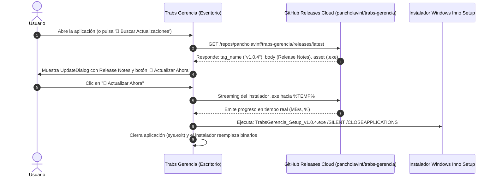

# 🖥️ Contexto Técnico de la Aplicación de Escritorio: Trabs Gerencia (`accuraop_gerencia`)

**Organización**: Accuratek  
**Fecha de Actualización**: Agosto 2026  
**Módulo**: Suite de Escritorio Administrativa y Financiera (`accuraop_gerencia`)  
**Versión de Producción**: 1.0.4 (Canal Oficial de Actualizaciones: [GitHub Releases `pancholavinf/trabs-gerencia`](https://github.com/pancholavinf/trabs-gerencia/releases))  
**Documento**: Guía Técnica Integral de Arquitectura, Concurrencia, Controladores, Módulos UI, Auto-Login y Pipeline de Auto-Actualizaciones

---

## 🛠️ 1. Stack Tecnológico y Dependencias

* **Lenguaje de Programación**: Python 3.10+ (Entorno virtual fijado en Python 3.12).
* **Framework de Interfaz Gráfica**: **PyQt6** (Arquitectura nativa de alto rendimiento con widgets personalizados, hojas de estilo `style.qss`, animaciones y sombras vectoriales `QGraphicsDropShadowEffect`).
* **Visualización y Gráficos Analíticos**: **Matplotlib** (`FigureCanvasQTAgg` y `Figure` embebidos directamente en paneles de Qt).
* **Compilación de Documentos Oficiales (PDF)**: **ReportLab** (Maquetación vectorial de Estados de Pago con logotipos institucionales, desgloses matriciales, cálculo de retenciones del 5% y cajas de firma formal).
* **Ingesta y Procesamiento de Datos**: **Pandas** y **openpyxl** (Lectura, limpieza, filtrado y tipado estricto de matrices Excel de cubicación técnica).
* **Conectividad a la Nube**: **supabase-py** y **requests** (Cliente oficial para Supabase Auth, base de datos relacional PostgreSQL 15+ y buckets S3 Storage).
* **Sistema de Auto-Actualizaciones (Auto-Updates)**: Módulo asíncrono con **GitHub Releases API REST** + **packaging** (parseo semántico de versiones) y streaming por bloques (*chunked download*).
* **Persistencia de Sesión (Auto-Login)**: **PyQt6.QtCore.QSettings** (Almacenamiento seguro del refresh token en el registro de Windows).
* **Empaquetado y Distribución**:
  * **PyInstaller** (`gerencia.spec` & `build_exe.py`): Compilación optimizada en modo carpeta autocontenida (`onedir`) con exclusión de binarios innecesarios (`scipy`, `lxml`, DLLs de renderizado por software) para mantener el instalador ultra ligero (~55 MB).
  * **Inno Setup** (`TrabsGerencia_Setup.iss`): Generador de instalador ejecutable único para Windows con compresión sólida `LZMA2 Ultra`, integración de iconos en escritorio, menú de inicio y soporte de actualización desatendida (`/SILENT /CLOSEAPPLICATIONS`).

---

## 📂 2. Estructura de Directorios Completa

```text
accuraop_gerencia/
├── main.py                          # Punto de entrada, inicialización de QApplication, verificación de sesión y arranque
├── requirements.txt                 # Especificación de dependencias fijadas
├── build_exe.py                     # Script de automatización de compilación con PyInstaller
├── publish_release.py               # Script de publicación automatizada CLI hacia GitHub Releases
├── COMPILAR_APP.bat                 # Lanzador bat para compilar el .exe con un solo clic
├── PUBLICAR_VERSION.bat             # Lanzador bat para publicar nuevas versiones a GitHub Releases
├── gerencia.spec                    # Archivo de configuración técnica de empaquetado PyInstaller
├── TrabsGerencia_Setup.iss          # Script de compilación de instalador oficial para Inno Setup
├── version.json                     # Manifiesto local de control de versiones
├── create-jefe-obra.js              # Script helper en Node.js para registro de supervisores en Supabase Auth
├── test_controller.py               # Suite de pruebas unitarias para controladores
├── assets/                          # Recursos gráficos institucionales, logotipos y animaciones
│   ├── app_icon.ico                 # Icono oficial multirresolución (16px a 256px) con fondo blanco
│   ├── logo_trabs_nombre_cf.png     # Logo Trabs con texto con fondo blanco
│   ├── logo_trabs_nombre_sf.png     # Logo Trabs con texto sin fondo (Sidebar)
│   ├── logo_trabs_circular_cf.png   # Logo circular Trabs con fondo blanco
│   ├── logo_trabs_circular_sf.png   # Logo circular Trabs sin fondo
│   ├── logo_trabs_solo_cf.png       # Isotipo Trabs con fondo blanco
│   ├── logo_trabs_solo_sf.png       # Isotipo Trabs sin fondo
│   ├── animacion_trabs.gif          # Animación institucional del Splash Screen
│   └── *.png                        # Sprites e iconos temáticos de estados, reportes y bitácoras
├── dist_installer/                  # Binarios de distribución final compilados
│   ├── TrabsGerencia_Setup_v1.0.2.exe # Instalador de producción v1.0.2
│   ├── TrabsGerencia_Setup_v1.0.3.exe # Instalador de producción v1.0.3
│   └── TrabsGerencia_Setup_v1.0.4.exe # Instalador de producción v1.0.4
├── documentos_edp/                  # Directorio local de respaldo para PDFs de Estados de Pago generados
└── src/
    ├── version.py                   # Fuente centralizada de versión y endpoint de GitHub Releases
    ├── core/
    │   ├── controller.py            # Controlador de Ingesta Excel (IngestaController) y diálogo de precios
    │   ├── data_manager.py          # DataManager Singleton (Caché TTL en memoria y ejecución segura thread-safe)
    │   ├── edp_controller.py        # Controlador de Estados de Pago (EDPController): cálculos, folios y congelamiento
    │   ├── jefes_controller.py      # Controlador CRUD para la administración de Supervisores de Obra
    │   ├── updater.py               # Motor asíncrono de Auto-Updates (CheckUpdateWorker, DownloadUpdateWorker e instalador)
    │   └── workers.py               # Colección de 35 hilos asíncronos (QThread) para el patrón Zero-Freeze
    ├── ui/
    │   ├── style.qss                # Hoja de estilos Qt oficial (Design System Trabs 2026 + Tooltips oscuros)
    │   ├── login_screen.py          # Pantalla de login con precarga de correo y pie institucional
    │   ├── main_view.py             # Ventana principal: Sidebar Antracita + QStackedWidget + Tooltips + Botón Verde Oliva
    │   ├── dashboard_view.py        # Dashboard general: KPIs, widget Asistencia Hoy y cuadrícula de obras
    │   ├── ingesta_view.py          # Vista asistida de importación y mapeo de planillas Excel de cubicación
    │   ├── jefes_view.py            # Vista modal/pestaña para gestión y asignación de Supervisores de Obra
    │   ├── avances_window.py        # Sub-vista de obra embebida (AvancesContent) con 4 pestañas operativas
    │   ├── control_personal_view.py # Vista de administración de cargos (tipos_maestro), maestros y asignación a faenas
    │   ├── reportes_asistencia_view.py # Vista de auditoría e historial de asistencia diaria con visor de fotos
    │   ├── materiales_view.py       # Catálogo maestro de insumos, unidades y rendimientos teóricos
    │   ├── edp_tab.py               # Pestaña de Estados de Pago, historial, KPIs y diálogo de emisión oficial
    │   ├── reportes_view.py         # Visor y módulo de respuesta a bitácoras de campo y novedades
    │   ├── update_dialog.py         # Diálogo modal interactivo de actualización con Release Notes y progreso
    │   └── document_viewer.py       # Visor integrado de PDFs y planos técnicos
    └── utils/
        └── pdf_edp_generator.py     # Motor ReportLab de maquetación vectorial para PDFs oficiales de EDP
```

---

## ⚡ 3. Concurrencia y Capa de Datos Asíncrona (`core/`)

Para asegurar que la interfaz de usuario nunca sufra congelamientos (*Zero-Freeze UX*), todas las operaciones I/O hacia Supabase PostgreSQL, Storage o GitHub Releases se ejecutan en subprocesos `QThread` comunicados con la interfaz mediante señales de Qt (`pyqtSignal`).

### 3.1 DataManager Singleton (`src/core/data_manager.py`)
El módulo `DataManager` centraliza el estado en memoria y optimiza el consumo de red:
* **Patrón Singleton con Bloqueo de Hilo**: Garantiza una única instancia accesible desde cualquier vista o controlador.
* **Caché TTL (5 minutos)**: Mantiene en memoria las consultas de catálogo (obras, supervisores, materiales, cargos y maestros) evitando consultas redundantes.
* **Tolerancia a Fallos de Socket en Windows (`_safe_execute`)**: Captura excepciones de socket no bloqueante (`WSAEWOULDBLOCK` / código de error `10035`), aplicando un mecanismo de reintento automático (*retry con backoff*) de hasta 3 intentos antes de propagar fallos.
* **Pull Inicial por Lotes (`fetch_initial_batch`)**: Ejecuta una sincronización estructurada al iniciar la sesión o al presionar el botón `"⚡ Resincronizar Datos"`, emitiendo porcentajes de avance a la barra de estado.

### 3.2 Catálogo de Workers Asíncronos (`src/core/workers.py` & `src/core/updater.py`)
La aplicación cuenta con **37 workers especializados**:

| Categoría | Workers Implementados | Función Principal |
| :--- | :--- | :--- |
| **Autenticación y Sesión** | `LoginWorker`<br>`SessionCheckWorker`<br>`LogoutWorker` | Autentica vía Supabase Auth, almacena/restaura tokens en `QSettings` de Windows para Auto-Login, valida en BD que el usuario no tenga rol `'jefe_obra'` y cierra sesión limpiando credenciales. |
| **Auto-Actualizaciones** | `CheckUpdateWorker`<br>`DownloadUpdateWorker` | Consulta la API pública de GitHub Releases (`/releases/latest`), compara versiones semánticas y descarga en streaming por bloques de 64 KB mostrando porcentaje y velocidad en MB/s. |
| **Carga de Datos** | `FetchInitialBatchWorker`<br>`FetchDashboardDataWorker`<br>`FetchJefesWorker`<br>`FetchObrasWorker`<br>`FetchObraDetailsWorker` | Realiza descargas masivas o específicas de obras, avances, cubicaciones y supervisores en segundo plano. |
| **Ingesta de Planillas** | `ProcessIngestaWorker` | Procesa el DataFrame de Excel, normaliza datos, sube el archivo al bucket `archivos_obras` y realiza el *bulk insert* en `items_obra`. |
| **Personal y Nómina** | `FetchTiposMaestroWorker`<br>`CreateTipoMaestroWorker`<br>`UpdateTipoMaestroWorker`<br>`DeleteTipoMaestroWorker`<br>`FetchMaestrosWorker`<br>`CreateMaestroWorker`<br>`UpdateMaestroWorker`<br>`DeleteMaestroWorker`<br>`AssignMaestroObraWorker`<br>`FetchMaestrosByObraWorker`<br>`UploadFotoPerfilWorker` | Administra cargos, tarifas diarias, fichas de maestros con fotos de perfil (bucket `accuratek-data`) y asignación a faenas (`obras_maestros`). |
| **Asistencia** | `FetchDashboardAsistenciaWorker`<br>`FetchAsistenciaReporteWorker` | Descarga la asistencia de la jornada actual para el Dashboard y consulta el historial por rangos de fecha con cálculo de costos. |
| **Catálogo Insumos** | `FetchMaterialesWorker`<br>`SaveMaterialWorker`<br>`UploadMaterialFileWorker`<br>`DeleteMaterialWorker` | Mantiene el catálogo global de materiales y rendimientos teóricos. |
| **Avances y Evidencia** | `UpdateAvanceStatusWorker`<br>`ImageDownloader` | Actualiza estados de revisión (`'aprobado'`, `'rechazado'`) y descarga fotos de evidencia desde Supabase Storage re-escalándolas al vuelo. |
| **Estados de Pago** | `FetchEDPHistorialWorker`<br>`EmitEDPWorker` | Consulta avances aprobados pendientes de cobro, calcula retenciones/anticipos, solicita folio con `get_next_edp_number`, compila PDF y congela avances. |
| **Bitácora de Campo** | `FetchReportesWorker`<br>`RespondReporteWorker` | Carga el libro diario de obras y publica respuestas formales de gerencia. |

---

## 🔄 4. Sistema de Auto-Actualizaciones (Auto-Updates)

El sistema de actualización continua permite que todos los computadores que ejecuten **Trabs Gerencia** se mantengan sincronizados con la última versión de forma transparente.



### Características Principales del Actualizador:
1. **Comprobación Dual (Silenciosa y Manual)**:
   * **Al iniciar**: Un temporizador (`QTimer.singleShot(2500, self.check_updates_background)`) realiza un chequeo no invasivo en segundo plano.
   * **Bajo demanda**: El botón `"🔄 Buscar Actualizaciones"` en la barra lateral permite forzar la búsqueda con retroalimentación visual (`QMessageBox` o `UpdateDialog`).
2. **Modal Interactivo (`UpdateDialog`)**:
   * Despliega la insignia de versión actual vs. nueva (`v1.0.3` ➔ `v1.0.4`).
   * Renderiza las notas de la versión (*Release Notes*) en formato HTML estilizado con viñetas claras.
   * Barra de progreso animada con indicador de megabytes transferidos (`24.5 MB / 56.0 MB`) y velocidad de descarga en MB/s.
3. **Instalación Desatendida (*Unattended Restart*)**:
   * Utiliza las directivas de Inno Setup `/SILENT`, `/CLOSEAPPLICATIONS` y `/RESTARTAPPLICATIONS=0` para cerrar el proceso anterior y reemplazar los ejecutables sin intervención del usuario.
4. **Script de Publicación Automatizada (`publish_release.py` / `PUBLICAR_VERSION.bat`)**:
   * Permite al desarrollador publicar una nueva versión con un solo comando:
     ```powershell
     .\PUBLICAR_VERSION.bat --version 1.0.4 --notes "• Descripción de los cambios..."
     ```
   * El script actualiza `src/version.py`, `TrabsGerencia_Setup.iss`, recompila PyInstaller, genera el instalador de Inno Setup, hace push a Git y crea el Release en GitHub con el archivo `.exe` adjunto vía API REST.

---

## 🔑 5. Persistencia de Sesión y Auto-Login

La aplicación implementa un flujo de autenticación persistente respaldado por el registro de Windows a través de `QSettings`:

1. **Al iniciar sesión por primera vez**:
   * `LoginWorker` autentica contra Supabase Auth con correo y contraseña.
   * Si las credenciales son válidas y el rol no es `'jefe_obra'`, almacena el `refresh_token` y el correo en `QSettings("Accuratek", "TrabsGerencia")`.
2. **En los siguientes inicios (Bypass de Login)**:
   * Durante la reproducción del video/animación del Splash Screen (~5.8s), el hilo `SessionCheckWorker` consulta el `refresh_token` guardado e invoca `supabase.auth.refresh_session(saved_refresh_token)`.
   * Al terminar el Splash, la app se salta la pantalla de inicio de sesión por completo y entra directamente a la vista principal y al Dashboard.
3. **Cierre de sesión seguro**:
   * Al hacer clic en `"Cerrar Sesión"` en la barra lateral, `LogoutWorker` elimina la clave del registro de Windows y ejecuta `supabase.auth.sign_out()`, volviendo a la pantalla de login con el correo precargado en el campo de texto.

---

## 🖥️ 6. Módulos Funcionales de la Interfaz (`src/ui/`)

### 6.1 Barra Lateral y Navegación Principal (`main_view.py`)
* **Diseño Institucional**: Fondo Antracita Oscuro (`#2D3033`) con borde divisorio Carbón Pizarra (`#414445`).
* **Tooltips en Todos los Botones**: Cuadros de ayuda flotantes oscuros (`#1F2115`) con tipografía Inter que describen la función de cada módulo al posar el cursor.
* **Botón de Sincronización**: Botón destacado `"⚡ Resincronizar Datos"` para forzar la actualización del caché TTL.
* **Botón de Actualizaciones**: Botón verde oliva `"🔄 Buscar Actualizaciones"` (`SidebarButtonUpdate`) para comprobación manual instantánea.
* **Badge de Estado**: Pie inferior con indicador `Trabs Gerencia v1.0.4 🟢 • Accuratek`.

### 6.2 Dashboard General y Asistencia Hoy (`dashboard_view.py`)
* **KPIs Consolidados**: Tarjetas con sombras vectoriales que resumen:
  * Total de Obras Activas / Pausadas / Finalizadas.
  * Dotación de personal presente en la jornada actual.
  * Porcentaje promedio de avance físico ponderado.
* **Widget Asistencia Hoy**: Desglose en tiempo real de cuadrillas y trabajadores presentes en faena reportados por los supervisores móviles.
* **Cuadrícula de Obras Activas**: Tarjetas interactivas con cabecera de color institucional de cada obra, nombres de los supervisores asignados y barra de progreso. Al hacer clic sobre cualquier tarjeta, navega automáticamente a la vista detallada de la obra.

### 6.3 Ingesta Asistida de Cubicaciones Excel (`ingesta_view.py` & `src/core/controller.py`)
* **Procesamiento de Planillas**: Carga planillas técnicas (`.xlsx`) respetando estructuras jerárquicas (Pisos, Ejes, Elementos, Partidas, $m^2$).
* **Diálogo de Asignación de Precios**: Permite al administrador parametrizar precios unitarios ($/m^2) antes de comprometer los registros a la base de datos.
* **Bulk Insert Transaccional**: Inserta los registros en `items_obra` y almacena la planilla original en el bucket `archivos_obras`.

### 6.4 Control y Auditoría de Obra (`avances_window.py` - `AvancesContent`)
Módulo centralizado con 4 pestañas operativas:
1. **Partidas y Avance Físico**:
   * Visualización matricial de cubicaciones por piso, sector y elemento.
   * Gráficos analíticos embebidos de **Matplotlib** (Curvas de avance, barras de rendimiento y avance por partida).
2. **Auditoría de Evidencias**:
   * Galería de fotos capturadas en terreno con metadatos de supervisor, fecha/hora y coordenadas.
   * Acciones de aprobación o rechazo de avances con actualización en tiempo real del estado de cobro.
3. **Estados de Pago (EDP) (`edp_tab.py`)**:
   * Historial de Estados de Pago emitidos con folios correlativos oficiales (`EDP-001`, `EDP-002`, etc.).
   * Generación y descarga de reportes oficiales en PDF (vía ReportLab) y planillas Excel de respaldo.
4. **Bitácora de Campo (`reportes_view.py`)**:
   * Libro digital de novedades, incidentes y observaciones registradas por los supervisores móviles.
   * Módulo de respuesta formal de gerencia con trazabilidad completa.

### 6.5 Control de Personal y Nómina (`control_personal_view.py`)
* **Gestión de Cargos (`tipos_maestro`)**: CRUD completo de especialidades (Maestro Mayor, Enfierrador, Pintor, Jornal, etc.) y sus tarifas diarias base.
* **Catálogo de Maestros**: Ficha de trabajadores con RUT, nombre, cargo, foto de perfil y estado de vigencia.
* **Asignación a Faenas**: Vinculación matricial de cuadrillas a obras específicas (`obras_maestros`).

### 6.6 Catálogo de Materiales e Insumos (`materiales_view.py`)
* Registro maestro de pinturas intumescentes, morteros, sellos y herramientas.
* Configuración de unidades de medida, costos unitarios y rendimientos teóricos por $m^2$.

### 6.7 Auditoría de Asistencia Diaria (`reportes_asistencia_view.py`)
* Módulo de auditoría con filtros por obra, subcontratista y rangos de fecha.
* Visor de fotos de cuadrilla y desglose de horas hombre trabajadas con costeo automático.

### 6.8 Visor Integrado de Documentos (`document_viewer.py`)
* Visor nativo de documentos técnicos, planos y PDFs de respaldo sin necesidad de abrir aplicaciones externas.

---

## 🚀 7. Pipeline de Compilación y Distribución

Para compilar la aplicación y generar los paquetes de distribución:

### 1. Compilación del Ejecutable (.EXE)
```powershell
.\COMPILAR_APP.bat
```
Genera la carpeta `accuraop_gerencia/dist/TrabsGerencia/` con el binario `TrabsGerencia.exe` (17.7 MB) autocontenido.

### 2. Generación del Instalador Oficial (Inno Setup)
Compila `accuraop_gerencia/TrabsGerencia_Setup.iss` generando `dist_installer/TrabsGerencia_Setup_v1.0.4.exe` (~55 MB) con compresión sólida `LZMA2 Ultra`.

### 3. Publicación de Nuevas Versiones
```powershell
.\PUBLICAR_VERSION.bat --version 1.0.4 --notes "• Novedades de la versión..."
```
O simplemente subiendo el archivo `dist_installer/TrabsGerencia_Setup_v1.0.4.exe` a la sección de **Releases** en GitHub.
