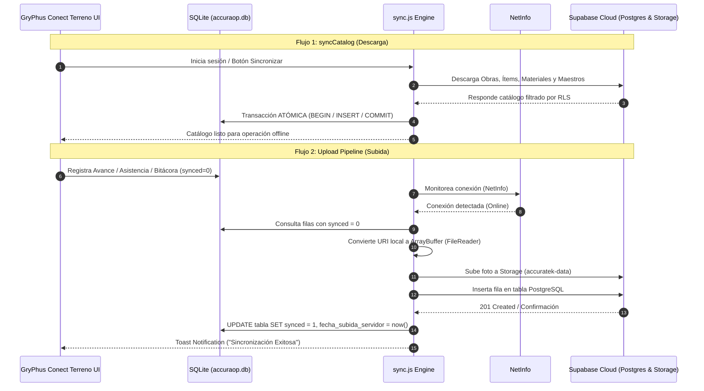
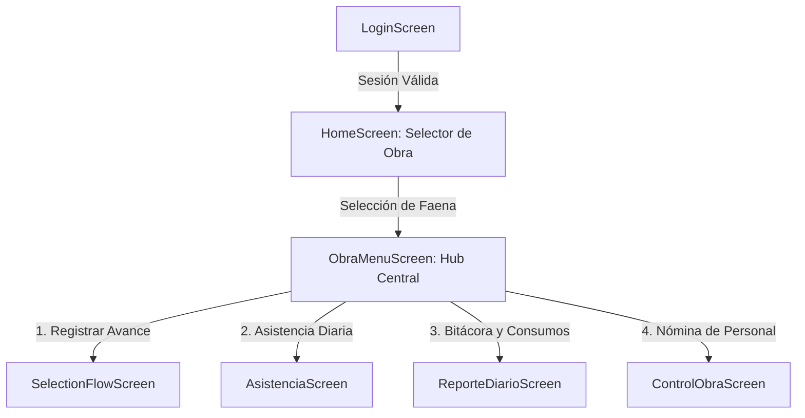

# 📱 Contexto Técnico de la Aplicación Móvil: GryPhus Conect Terreno (`gryphus_conect_terreno`)

**Organización**: Gryphus Systems  
**Fecha de Actualización**: Agosto 2026  
**Módulo**: Aplicación Móvil de Captura y Supervisión en Faena (`gryphus_conect_terreno`)  
**Ecosistema**: GryPhus Conect — Control Operativo de Protección Pasiva y Obra  
**Documento**: Arquitectura Técnica, Motor Offline-First, Pipeline de Sincronización, Pantallas y Test Suite

---

## 🛠️ 1. Stack Tecnológico y Dependencias

* **Framework Base**: **React Native** con **Expo SDK 54** (arquitectura moderna basada en Hermes Engine).
* **Base de Datos Local (Offline-First)**: **expo-sqlite** (Base de datos transaccional SQLite local: `accuraop.db`).
* **Conectividad y Backend en la Nube**: **@supabase/supabase-js** (Cliente oficial para Supabase Auth, PostgreSQL y S3-compatible Storage).
* **Detección de Red y Conectividad**: **@react-native-community/netinfo** (Monitoreo de estado de red para disparo reactivo de sincronizaciones).
* **Captura y Compresión de Imágenes**: 
  * `expo-camera` (Captura fotográfica nativa de evidencias).
  * `expo-image-manipulator` (Compresión en caliente y reescalado para optimización de ancho de banda).
* **Navegación**: `@react-navigation/native` y `@react-navigation/native-stack`.
* **Notificaciones In-App**: `react-native-toast-message` (Toasts personalizados con iconos de éxito, error y sincronización).
* **Tipografías Corporativas**: `@expo-google-fonts/montserrat` (Montserrat Bold/SemiBold) y `@expo-google-fonts/inter` (Inter Regular/Medium/Bold).

---

## 📂 2. Estructura de Directorios Completa

```text
gryphus_conect_terreno/
├── App.js                           # Contenedor raíz, carga de fuentes, verificación de sesión, navegación y ciclo de vida de sync
├── app.json                         # Configuración de Expo (nombre, bundle id, splash, orientaciones)
├── package.json                     # Dependencias y scripts de ejecución
├── babel.config.js / metro.config.js # Configuración del empaquetador Metro y plugins de Babel
├── eas.json                         # Configuración de compilación en la nube para Expo Application Services
├── .env                             # Variables de entorno seguras (EXPO_PUBLIC_SUPABASE_URL, etc.)
├── assets/                          # Logotipos GryPhus Conect, splash screen, iconos adaptativos y sprites UI
│   ├── splash.png                   # Pantalla de carga inicial
│   ├── icon.png / adaptive-icon.png # Iconos de la aplicación móvil
│   ├── logo_trabs_*.png             # Variantes de marca GryPhus Conect (circular, con nombre, con fondo y sin fondo)
│   └── sprites/                     # Iconos temáticos de toast (listo_logo, error_logo, camara_logo)
├── src/
│   ├── constants/
│   │   └── theme.js                 # Design Tokens oficiales GryPhus Conect 2026 (Paleta de colores, tipografías y sombras)
│   ├── database/
│   │   ├── db.js                    # Capa de abstracción SQLite (accuraop.db): inicialización de tablas, queries y colas unsynced
│   │   └── sync.js                  # Pipeline de sincronización bidireccional (syncCatalog, syncAvances, syncAsistencias, syncReportes, auto-sync)
│   ├── screens/
│   │   ├── LoginScreen.js           # Inicio de sesión mediante Supabase Auth con validación de credenciales
│   │   ├── HomeScreen.js            # Selector de obras asignadas con tarjetas cromáticas e indicador de conectividad
│   │   ├── ObraMenuScreen.js        # Menú principal de faena: 4 accesos rápidos a módulos operativos
│   │   ├── SelectionFlowScreen.js   # Wizard interactivo de registro de avances por m² con captura de fotos
│   │   ├── ReporteDiarioScreen.js   # Bitácora diaria de obra (incidentes/novedades) y reporte de consumo de insumos
│   │   ├── AsistenciaScreen.js      # Pase de lista diario de maestros con foto grupal y reportes correctivos
│   │   └── ControlObraScreen.js     # Consulta offline de la nómina de trabajadores asignados, cargos y RUT/DNI
│   ├── services/
│   │   ├── supabase.js              # Inicialización y exportación del cliente singleton de Supabase
│   │   ├── imageCompressor.js       # Utilidad de compresión y redimensionamiento de fotos de terreno
│   │   └── memoryCache.js           # Almacenamiento en memoria para desarrollo web y respuesta instantánea de UI
│   └── web-stubs/                   # Entornos mock para ejecución web y testing en entornos no nativos
│       ├── expo-camera-stub.js
│       ├── expo-image-manipulator-stub.js
│       └── expo-sqlite-stub.js
└── tests/                           # Suite de pruebas automatizadas en 6 niveles (Jest)
    ├── setup.js                     # Configuración de mocks globales de testing
    ├── tier1_feature.test.js        # Pruebas de funcionalidad y renderizado de pantallas
    ├── tier2_boundary.test.js       # Pruebas de casos de borde y límites de datos
    ├── tier3_integration.test.js    # Pruebas de integración SQLite + Navegación
    ├── tier4_workload.test.js       # Pruebas de estrés y volumen de ítems
    ├── tier5_profile.test.js        # Pruebas de actualización de perfil de usuario
    └── tier6_control_obra.test.js   # Pruebas del módulo de consulta de nómina en terreno
```

---

## 💾 3. Arquitectura Offline-First y Base de Datos Local (`db.js`)

En las obras de construcción, la conectividad suele ser nula, intermitente o de baja calidad. Por ello, **GryPhus Conect Terreno** opera bajo un diseño **100% Offline-First**:

1. **Persistencia Local Inmediata**: Cualquier acción realizada por el supervisor (un avance en m², una bitácora o una asistencia) se escribe de manera inmediata y sincrónica en la base de datos **SQLite local (`accuraop.db`)** con la bandera `synced = 0`.
2. **Esquema Relacional Homólogo**: Las tablas locales de SQLite replican exactamente los nombres de campos y tipos del PostgreSQL remoto en Supabase:
   * `obras`
   * `obras_jefes_obra`
   * `items_obra`
   * `avances` (`id`, `item_obra_id`, `jefe_obra_id`, `cantidad`, `comentario`, `foto_url`, `fecha_captura_local`, `fecha_subida_servidor`, `estado_revision`, `synced`)
   * `tipos_maestro`
   * `maestros`
   * `obras_maestros`
   * `materiales`
   * `reporte_obra` (`id`, `obra_id`, `jefe_obra_id`, `tipo_reporte`, `mensaje`, `archivos_adjuntos`, `fecha_publicacion`, `estado_reb`, `synced`)
   * `reporte_obra_consumos`
   * `asistencia_diaria` (`id`, `obra_id`, `jefe_obra_id`, `fecha`, `foto_url`, `es_correctivo`, `observaciones`, `fecha_registro`, `synced`)
   * `asistencia_diaria_detalle`
3. **Inmutabilidad y Marcas Temporales**: La aplicación genera un `id` (UUID v4) y registra la `fecha_captura_local` en el dispositivo al momento exacto de la acción física, garantizando la trazabilidad temporal del trabajo en terreno.

---

## 🔄 4. Pipeline de Sincronización en Segundo Plano (`sync.js`)

El pipeline de sincronización administra de forma transparente la bidireccionalidad de los datos entre SQLite y Supabase Cloud:



### 4.1 Descarga de Catálogo (`syncCatalog(jefeId)`)
* Ejecutado al iniciar sesión exitosamente o al forzar la resincronización.
* Consulta en Supabase las obras asignadas al supervisor (`obras`), los ítems técnicos asociados (`items_obra`), el catálogo de cargos (`tipos_maestro`), el catálogo de insumos (`materiales`) y los trabajadores asignados a sus proyectos (`maestros` y `obras_maestros`).
* Ejecuta una **transacción atómica (`BEGIN TRANSACTION / COMMIT`)** en SQLite para reemplazar o actualizar las tablas locales sin riesgo de inconsistencias.

### 4.2 Subida de Fotografías con Hermes ArrayBuffer (`uploadLocalPhoto`)
En el motor JavaScript Hermes de React Native, las peticiones HTTP convencionales con objetos `Blob` o `FormData` de imágenes locales (`file://` o `content://`) presentan problemas de incompatibilidad de red. Para solucionar esto de raíz:
1. La imagen local se lee en memoria como Blob.
2. Un objeto `FileReader` convierte el contenido a un `ArrayBuffer` binario puro.
3. El `ArrayBuffer` se transmite directamente al cliente de Supabase Storage al bucket **`accuratek-data`** con `contentType: 'image/jpeg'`.
4. Supabase devuelve la URL pública final que se almacena en el registro de PostgreSQL.

### 4.3 Canales de Sincronización de Datos
* **`syncAvances()`**: Recorre `getUnsyncedAvances()`, sube las fotos al bucket `accuratek-data` (ruta `avances/{jefe_id}/{avance_id}.jpg`), inserta en la tabla `avances` con estado `'pendiente'` y marca `synced = 1`.
* **`syncAsistencias()`**: Recorre `getUnsyncedAsistencias()`, sube la foto grupal al bucket `accuratek-data` (ruta `asistencia/{jefe_id}/{asistencia_id}.jpg`), inserta la cabecera en `asistencia_diaria` e inserta masivamente el desglose en `asistencia_diaria_detalle`.
* **`syncReportes()`**: Recorre `getUnsyncedReportes()`, sube los archivos adjuntos al bucket `accuratek-data` (ruta `bitacora/{jefe_id}/{reporte_id}_{idx}.jpg`), inserta la bitácora en `reporte_obra` y los consumos asociados en `reporte_obra_consumos`.
* **Auto-Sync en Segundo Plano (`startBackgroundSync`)**: Tarea en bucle con intervalo de 60 segundos que detecta reconexiones a internet mediante `NetInfo`, vacía las colas pendientes y dispara notificaciones Toast amigables.

---

## 📱 5. Pantallas y Experiencia de Usuario (`src/screens/`)



### 5.1 `LoginScreen.js` (Acceso Seguro)
* Campos de correo electrónico y contraseña con diseño enfocado y validación interactiva.
* Al autenticarse, guarda la sesión y ejecuta automáticamente `syncCatalog` para dejar el smartphone 100% operativo sin necesidad de conexión posterior.

### 5.2 `HomeScreen.js` (Selector de Faenas)
* Cabecera superior oscura en Antracita Oscuro (`#262B29`) con avatar del supervisor y su nombre.
* Indicador visual de estado de sincronización (Punto verde: Todo al día / Punto ámbar: Registros pendientes / Punto rojo: Sin conexión).
* Lista de tarjetas de obra con borde cromático identificador, estado operativo (`Activa` / `Pausada`) y botón de acceso directo.
* Botón de cierre de sesión seguro.

### 5.3 `ObraMenuScreen.js` (Hub Operativo de Obra)
Pantalla central que despliega las 4 operaciones clave de la faena seleccionada:
1. **Registrar Avance**: Acceso al flujo de cubicación y progreso de metros cuadrados.
2. **Asistencia Diaria**: Acceso a la toma de presentismo del personal asignado.
3. **Novedades y Bitácora**: Acceso al cuaderno diario y reporte de consumos de insumos.
4. **Control de Obra**: Acceso a la lista de trabajadores activos y sus cargos.

### 5.4 `SelectionFlowScreen.js` (Registro de Avances por m² y Publicación Multi-ítem)
Asistente interactivo por pasos para evitar errores de digitación con soporte para **lotes multi-ítem con una sola foto**:
* **Paso 1: Selección de Sector / Ubicación / Estructura / Dimensión**: Despliega y filtra los elementos presupuestados (vigas, pilares, diagonales), autoadelantando pasos con opción única.
* **Paso 2: Ingreso de Cantidad y Gestión de Lote**:
  * Input numérico para ingresar la cantidad ejecutada.
  * Botón **"+ Agregar otro ítem al lote"**: Añade el ítem actual al lote en memoria (sumando cantidad si el ítem ya existía) y reinicia el selector para elegir el siguiente elemento, mostrando un banner superior persistente con el conteo de ítems acumulados.
  * Botón **"Continuar → Foto"**: Consolida los ítems del lote y pasa a la toma de fotografía común.
* **Paso 3: Captura de Evidencia Fotográfica Única**:
  * **Cámara / Galería Obligatoria**: Captura una sola imagen que sirve como evidencia de respaldo para todos los ítems del lote.
  * Compresión automática mediante `imageCompressor.js`.
* **Paso 4: Comentario General**: Observaciones aplicadas a todo el lote.
* **Paso 5: Confirmación y Envío**:
  * Despliega la lista de tarjetas de ítems incluidos con botón `✕` para remover elementos individuales.
  * Al confirmar, inserta $N$ registros en SQLite (`avances`) compartiendo la misma URI de foto.
  * `syncAvances` optimiza la subida deduplicando la foto y subiéndola a Supabase Storage una sola vez, reutilizando la URL pública remota para todas las filas.

### 5.5 `AsistenciaScreen.js` (Pase de Lista Diario)
* Visualización de la fecha de la jornada laboral.
* Lista de maestros asignados a la obra con selector rápido de 3 estados:
  * **Presente** (Jornada 1.0) — Verde
  * **Medio Día** (Jornada 0.5) — Ámbar
  * **Ausente** (Jornada 0.0) — Gris/Rojo
* Captura obligatoria de **Foto Grupal de Evidencia** de la faena.
* Interruptor (*switch*) para marcar como **Reporte Correctivo** (`es_correctivo = true`) en caso de rectificaciones posteriores.
* Campo de observaciones y guardado transaccional.

### 5.6 `ReporteDiarioScreen.js` (Bitácora y Consumos)
* Selector de categoría de reporte: `'actualizacion'`, `'incidente'`, `'accidente'`, `'otro'`.
* Área de texto para redacción de novedades y observaciones de la jornada.
* Adjunto de múltiples fotografías de evidencia.
* **Sección de Consumo de Materiales**: Permite seleccionar insumos catalogados o ingresar insumos no registrados, especificando la cantidad y la unidad utilizada en el día (`reporte_obra_consumos`).

### 5.7 `ControlObraScreen.js` (Nómina y Consulta Offline)
* Consulta rápida y 100% offline del personal activo en la obra.
* Tarjetas con Nombre, Cargo asignado (`tipos_maestro`), RUT / DNI y teléfono de contacto directo.

---

## 🧪 6. Suite de Pruebas Automatizadas (Test Suite en 6 Niveles)

El proyecto cuenta con un arnés de pruebas automatizadas con Jest y React Native Testing Library:

| Nivel (Tier) | Archivo de Prueba | Cobertura / Objetivo |
| :--- | :--- | :--- |
| **Tier 1: Feature** | `tier1_feature.test.js` | Renderizado correcto de componentes, botones de navegación y renderizado condicional según estado de autenticación. |
| **Tier 2: Boundary** | `tier2_boundary.test.js` | Manejo de entradas extremas: textos nulos, números negativos, pérdida súbita de conectividad y timeout de red. |
| **Tier 3: Integration** | `tier3_integration.test.js` | Flujo integrado entre Auth, navegación entre pantallas y llamadas de base de datos local SQLite. |
| **Tier 4: Workload** | `tier4_workload.test.js` | Rendimiento bajo volumen masivo (listas con cientos de ítems de cubicación y maestros). |
| **Tier 5: Profile** | `tier5_profile.test.js` | Persistencia y modificación de metadatos de usuario y actualización reactiva de la interfaz. |
| **Tier 6: Control Obra** | `tier6_control_obra.test.js` | Validación de consultas de nómina de personal asignado a obras específicas y visualización de cargos. |
