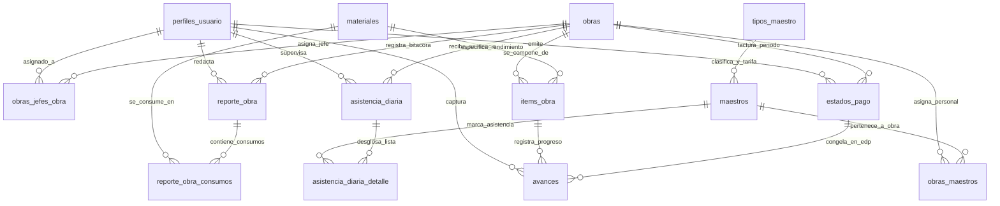

# 🗃️ Documentación y Contexto Técnico: Base de Datos y Modelo Relacional

**Organización**: Accuratek  
**Fecha de Actualización**: Agosto 2026  
**Motor de Base de Datos**: PostgreSQL 15+ (Alojado en Supabase Cloud)  
**Ecosistema**: Trabs (Trabs Gerencia + Trabs Terreno)  
**Documento**: Diccionario Completo de Datos, Diagrama E-R, Procedimientos Almacenados, Vistas, Políticas RLS y Storage

---

## 📐 1. Diagrama de Entidad-Relación (E-R Completo)

Todas las entidades utilizan identificadores únicos universales (`UUID v4`) como llaves primarias, garantizando la interoperabilidad sin colisiones entre dispositivos móviles que operan *offline* y el servidor central en la nube.



---

## 🗄️ 2. Diccionario de Tablas del Esquema

### A. Control de Acceso, Usuarios y Asignación

#### 1. `perfiles_usuario`
Extensión del perfil público vinculado a la tabla interna de autenticación `auth.users(id)`.
* `id` (`uuid`, PK): Referencia directa a `auth.uid()`.
* `nombre` (`varchar(200)`, NOT NULL): Nombre y apellido del usuario.
* `email` (`text`, NOT NULL, UNIQUE): Correo institucional.
* `rol` (`varchar(50)`, NOT NULL): Rol en la plataforma (`'administrador'`, `'jefe_obra'`).
* `foto_perfil_url` (`text`, NULL): URL de la foto en el bucket `accuratek-data`.
* `clave` (`text`, NULL): Respaldo hash/identificador para auditoría.
* `telefono` (`text`, NULL): Número de contacto.
* `rut_dni` (`varchar(50)`, NULL): Identificador nacional de identidad.

#### 2. `obras_jefes_obra`
Tabla de asignación intermedia entre obras y supervisores responsables.
* `id` (`uuid`, PK, Default `gen_random_uuid()`): Llave primaria.
* `obra_id` (`uuid`, NOT NULL, FK -> `obras(id)` ON DELETE CASCADE).
* `jefe_obra_id` (`uuid`, NOT NULL, FK -> `perfiles_usuario(id)` ON DELETE CASCADE).
* *Restricción*: Un supervisor puede tener múltiples obras asignadas y viceversa.

---

### B. Proyectos, Partidas y Presupuestos

#### 3. `obras`
Proyectos de construcción y contratos de faena.
* `id` (`uuid`, PK, Default `gen_random_uuid()`): Identificador único de la faena.
* `nombre` (`varchar(255)`, NOT NULL): Nombre formal del proyecto.
* `estado` (`varchar(50)`, NOT NULL, Default `'Activa'`): Estado operativo (`'Activa'`, `'Pausada'`, `'Finalizada'`).
* `fecha_creacion` (`timestamptz`, Default `now()`): Fecha y hora de creación.
* `color` (`text`, NULL): Código hexadecimal (HEX) para tematización y badges en UI.

#### 4. `items_obra` (Cubicaciones y Presupuesto de Contrato)
Partidas técnicas cargadas masivamente desde la hoja `'CUBICACION'` de la planilla Excel.
* `id` (`uuid`, PK, Default `gen_random_uuid()`): Identificador de la partida.
* `obra_id` (`uuid`, NOT NULL, FK -> `obras(id)` ON DELETE CASCADE).
* `ubicacion` (`varchar(255)`): Sector físico o eje en faena.
* `plano` (`varchar(100)`): Código de plano estructural.
* `descripcion_plano` (`text`): Glosa descriptiva del plano.
* `estructura` (`varchar(100)`): Tipo de elemento (Viga, Pilar, Diagonal, Arriostre).
* `dimension` (`varchar(100)`): Dimensión geométrica.
* `perfil` (`varchar(100)`): Tipo de perfil metálico (H, IPE, Cajón, Tubo).
* `cantidad` (`numeric`): Cantidad total de elementos presupuestados.
* `cantidad_estructuras` (`numeric`): Conteo de elementos estructurales.
* `largo_mm` (`numeric`): Longitud lineal en milímetros.
* `caras_expuestas` (`int4`): Caras expuestas al fuego (1, 2, 3 o 4).
* `perimetro_expuesto_mm` (`numeric`): Perímetro expuesto en milímetros.
* `resist_fuego` (`varchar(50)`): Resistencia al fuego requerida (ej: F-60, F-90, F-120).
* `masividad_m1` (`numeric`): Factor de masividad ($M^{-1}$).
* `area_expuesta_m2` (`numeric`): Área superficial total a proteger en metros cuadrados ($m^2$).
* `material` (`varchar(255)`): Nombre del recubrimiento protector.
* `certificacion` (`varchar(100)`): Norma técnica asociada.
* `micras` (`numeric`): Espesor de película seca teórico en micras ($\mu m$).
* `formula` (`text`): Expresión matemática de cálculo de insumo.
* `tinetas` / `sacos` (`numeric`): Consumo teórico total calculado en unidades de empaque.
* `precio_unitario_contrato` (`numeric`, Default 0): Valor unitario en pesos pactado por contrato.
* `material_id` (`uuid`, NULL, FK -> `materiales(id)` ON DELETE SET NULL).
* `anotaciones` (`text`, NULL): Observaciones técnicas del proceso de ingesta.

---

### C. Ejecución, Avances y Cierre Financiero (EDP)

#### 5. `avances`
Registro del avance físico cuantitativo en metros cuadrados reportado desde terreno.
* `id` (`uuid`, PK, Default `gen_random_uuid()`): Identificador del registro.
* `item_obra_id` (`uuid`, NOT NULL, FK -> `items_obra(id)` ON DELETE CASCADE).
* `jefe_obra_id` (`uuid`, NOT NULL, FK -> `perfiles_usuario(id)`).
* `estado_pago_id` (`uuid`, NULL, FK -> `estados_pago(id)` ON DELETE SET NULL): Si no es NULL, indica que el avance fue liquidado y congelado en un Estado de Pago oficial.
* `foto_url` (`text`, NOT NULL): URL pública de la foto de evidencia en el bucket `avance-fotos`.
* `comentario` (`text`, NULL): Glosa descriptiva u observaciones del trabajo realizado.
* `cantidad` (`numeric`, NOT NULL): Metros cuadrados ($m^2$) terminados en el registro.
* `fecha_captura_local` (`timestamp`, NOT NULL): Marca temporal del reloj del dispositivo en terreno.
* `fecha_subida_servidor` (`timestamp`, NULL): Marca temporal de inserción en Supabase Cloud.
* `estado_revision` (`varchar(30)`, Default `'pendiente'`): Estado de aprobación gerencial (`'pendiente'`, `'aprobado'`, `'rechazado'`).

#### 6. `estados_pago`
Tabla maestra de Estados de Pago emitidos para cobro formal. Cada registro consolida y congela un período financiero.
* `id` (`uuid`, PK, Default `gen_random_uuid()`): Identificador único del EDP.
* `obra_id` (`uuid`, NOT NULL, FK -> `obras(id)` ON DELETE CASCADE).
* `numero_estado_pago` (`integer`, NOT NULL): Folio correlativo por obra (1, 2, 3...).
* `fecha_emision` (`timestamptz`, NOT NULL, Default `now()`): Fecha y hora de emisión formal.
* `periodo_desde` (`date`, NULL) / `periodo_hasta` (`date`, NULL): Rango de fechas cubierto por el cobro.
* `subtotal_pesos` (`numeric(18,2)`, NOT NULL, Default 0): Sumatoria de los montos de avances aprobados incluidos.
* `monto_retencion` (`numeric(18,2)`, NOT NULL, Default 0): Descuento por retención de garantía de contrato.
* `monto_anticipo` (`numeric(18,2)`, NOT NULL, Default 0): Descuento por amortización de anticipo financiero.
* `monto_neto` (`numeric(18,2)`, NOT NULL, Default 0): Subtotal menos retención y menos anticipo.
* `monto_iva` (`numeric(18,2)`, NOT NULL, Default 0): Impuesto al Valor Agregado (19% sobre el monto neto).
* `monto_total` (`numeric(18,2)`, NOT NULL, Default 0): Monto total facturable a cobrar (Neto + IVA).
* `orden_trabajo_num` (`varchar(100)`, NULL): Número de orden de compra u orden de trabajo.
* `archivo_pdf_url` (`text`, NULL): URL del PDF generado en el bucket `estados_pago`.
* `creado_por` (`uuid`, NULL, FK -> `perfiles_usuario(id)` ON DELETE SET NULL).
* `observaciones` (`text`, NULL): Glosa comercial o técnica.
* *Restricción de unicidad*: `CONSTRAINT uq_estados_pago_folio UNIQUE (obra_id, numero_estado_pago)`.

---

### D. Bitácora de Obra y Consumo de Insumos

#### 7. `reporte_obra`
Cuaderno de novedades y bitácora diaria de la faena.
* `id` (`uuid`, PK, Default `gen_random_uuid()`): Llave primaria.
* `obra_id` (`uuid`, NOT NULL, FK -> `obras(id)` ON DELETE CASCADE).
* `jefe_obra_id` (`uuid`, NOT NULL, FK -> `perfiles_usuario(id)`).
* `tipo_reporte` (`text`, Default `'actualizacion'`): Categoría (`'actualizacion'`, `'incidente'`, `'accidente'`, `'otro'`).
* `mensaje` (`text`, NOT NULL): Descripción detallada del reporte.
* `archivos_adjuntos` (`text[]`, Default `'{}'`): Array de URLs de fotos subidas al bucket `bitacora-fotos`.
* `fecha_publicacion` (`timestamptz`, Default `now()`): Fecha y hora de captura.
* `estado_reb` (`text`, Default `'pendiente'`): Estado de revisión (`'pendiente'`, `'leido'`, `'respondido'`).
* `respuesta` (`boolean`, Default `false`): Indica si gerencia emitió feedback.
* `mensaje_respuesta` (`text`, NULL): Comentario o respuesta formal de gerencia.

#### 8. `reporte_obra_consumos`
Insumos materiales utilizados durante la jornada y asociados a la bitácora diaria.
* `id` (`uuid`, PK, Default `gen_random_uuid()`): Llave primaria.
* `reporte_obra_id` (`uuid`, NOT NULL, FK -> `reporte_obra(id)` ON DELETE CASCADE).
* `material_id` (`uuid`, NULL, FK -> `materiales(id)` ON DELETE SET NULL).
* `material` (`text`, NOT NULL): Nombre del insumo en texto plano.
* `cantidad` (`numeric`, NOT NULL): Cantidad utilizada en la faena.
* `unidad` (`text`, NOT NULL): Unidad de medida (`'tinetas'`, `'sacos'`, `'kg'`).
* `fecha` (`timestamptz`, Default `now()`): Fecha del registro.

---

### E. Catálogo Maestro de Materiales

#### 9. `materiales`
Base de datos centralizada de insumos de protección pasiva.
* `id` (`uuid`, PK, Default `gen_random_uuid()`): Llave primaria.
* `nombre` (`text`, NOT NULL, UNIQUE): Nombre del recubrimiento protector.
* `unidad_medida` (`text`, NOT NULL): Unidad (`'tinetas'`, `'sacos'`, `'kg'`).
* `rendimiento_teorico_m2` (`numeric`, Default 0): Rendimiento por m² terminado ($m^2/\text{unidad}$).
* `descripcion` (`text`, NULL): Especificaciones técnicas y recomendaciones de aplicación.

---

### F. Control de Personal, Nómina y Asistencia Diaria

#### 10. `tipos_maestro`
Catálogo maestro de cargos/posiciones y tarifas de sueldo diario.
* `id` (`uuid`, PK, Default `gen_random_uuid()`): Llave primaria.
* `nombre` (`varchar(100)`, NOT NULL, UNIQUE): Cargo (ej: `'Aplicador'`, `'Pintor'`, `'Ayudante'`, `'Mallero'`).
* `sueldo_diario` (`numeric(10,2)`, NOT NULL, Default `0.00`): Tarifa pactada por jornada completa (1.0).
* `fecha_creacion` (`timestamptz`, Default `now()`).

#### 11. `maestros`
Fichas individuales de trabajadores y personal técnico de faena.
* `id` (`uuid`, PK, Default `gen_random_uuid()`): Llave primaria.
* `nombre` (`varchar(200)`, NOT NULL): Nombre completo del trabajador.
* `rut_dni` (`varchar(50)`, NULL): Identificador nacional de identidad.
* `tipo_maestro_id` (`uuid`, NOT NULL, FK -> `tipos_maestro(id)` ON DELETE RESTRICT): Cargo asignado que define su tarifa diaria.
* `telefono` (`varchar(30)`, NULL): Teléfono de contacto.
* `foto_perfil_url` (`text`, NULL): Fotografía del trabajador alojada en el bucket `accuratek-data`.
* `estado` (`varchar(20)`, NOT NULL, Default `'Activo'`): Condición laboral (`'Activo'`, `'Inactivo'`).
* `fecha_creacion` (`timestamptz`, Default `now()`).

#### 12. `obras_maestros`
Tabla de asignación de maestros a proyectos activos.
* `obra_id` (`uuid`, NOT NULL, FK -> `obras(id)` ON DELETE CASCADE).
* `maestro_id` (`uuid`, NOT NULL, FK -> `maestros(id)` ON DELETE CASCADE).
* `fecha_asignacion` (`timestamptz`, Default `now()`).
* `PRIMARY KEY (obra_id, maestro_id)`.

#### 13. `asistencia_diaria`
Cabecera del registro de asistencia capturado diariamente en terreno.
* `id` (`uuid`, PK, Default `gen_random_uuid()`): Llave primaria.
* `obra_id` (`uuid`, NOT NULL, FK -> `obras(id)` ON DELETE CASCADE).
* `jefe_obra_id` (`uuid`, NOT NULL, FK -> `perfiles_usuario(id)`).
* `fecha` (`date`, NOT NULL): Fecha de la jornada laboral auditada.
* `foto_url` (`text`, NULL): URL de la foto de evidencia grupal en el bucket `asistencia-fotos`.
* `es_correctivo` (`boolean`, NOT NULL, Default `false`): Marca si el reporte corresponde a una rectificación posterior.
* `observaciones` (`text`, NULL): Glosa de la faena del día.
* `fecha_registro` (`timestamptz`, Default `now()`): Momento exacto de captura/sincronización.

#### 14. `asistencia_diaria_detalle`
Desglose individual de presentismo por cada trabajador.
* `id` (`uuid`, PK, Default `gen_random_uuid()`): Llave primaria.
* `asistencia_id` (`uuid`, NOT NULL, FK -> `asistencia_diaria(id)` ON DELETE CASCADE).
* `maestro_id` (`uuid`, NOT NULL, FK -> `maestros(id)` ON DELETE CASCADE).
* `estado` (`varchar(20)`, NOT NULL, CHECK: `'presente'`, `'medio_dia'`, `'ausente'`).
* `valor_jornada` (`numeric(3,1)`, NOT NULL, CHECK: `1.0`, `0.5`, `0.0`): Factor multiplicador del sueldo diario.
* `observacion` (`text`, NULL): Justificación o nota específica del trabajador.
* `CONSTRAINT uq_asistencia_maestro UNIQUE (asistencia_id, maestro_id)`.

---

## 📊 3. Vistas Analíticas y Procedimientos Almacenados

### 3.1 Vista `v_asistencia_resumen`
Consolida la asistencia por obra y fecha, calculando automáticamente el costo laboral devengado:
```sql
CREATE OR REPLACE VIEW public.v_asistencia_resumen AS
SELECT
    add.asistencia_id,
    ad.obra_id,
    o.nombre                                   AS obra_nombre,
    ad.fecha,
    ad.es_correctivo,
    m.id                                       AS maestro_id,
    m.nombre                                   AS maestro_nombre,
    m.rut_dni,
    tm.nombre                                  AS tipo_nombre,
    tm.sueldo_diario,
    add.estado,
    add.valor_jornada,
    (add.valor_jornada * tm.sueldo_diario)     AS pago_jornada
FROM public.asistencia_diaria_detalle add
JOIN public.asistencia_diaria         ad  ON ad.id  = add.asistencia_id
JOIN public.obras                     o   ON o.id   = ad.obra_id
JOIN public.maestros                  m   ON m.id   = add.maestro_id
JOIN public.tipos_maestro             tm  ON tm.id  = m.tipo_maestro_id;
```

### 3.2 Vista `v_edp_resumen`
Consolida el historial de Estados de Pago con conteo de partidas cobradas:
```sql
CREATE OR REPLACE VIEW public.v_edp_resumen AS
SELECT
    ep.id,
    ep.obra_id,
    o.nombre                             AS obra_nombre,
    ep.numero_estado_pago,
    ep.fecha_emision,
    ep.periodo_desde,
    ep.periodo_hasta,
    ep.subtotal_pesos,
    ep.monto_retencion,
    ep.monto_anticipo,
    ep.monto_neto,
    ep.monto_iva,
    ep.monto_total,
    ep.orden_trabajo_num,
    ep.archivo_pdf_url,
    ep.creado_por,
    p.nombre                             AS creado_por_nombre,
    COUNT(av.id)                         AS cant_avances_incluidos
FROM public.estados_pago ep
JOIN public.obras o
    ON o.id = ep.obra_id
LEFT JOIN public.perfiles_usuario p
    ON p.id = ep.creado_por
LEFT JOIN public.avances av
    ON av.estado_pago_id = ep.id
GROUP BY
    ep.id, ep.obra_id, o.nombre, ep.numero_estado_pago,
    ep.fecha_emision, ep.periodo_desde, ep.periodo_hasta,
    ep.subtotal_pesos, ep.monto_retencion, ep.monto_anticipo,
    ep.monto_neto, ep.monto_iva, ep.monto_total,
    ep.orden_trabajo_num, ep.archivo_pdf_url, ep.creado_por,
    p.nombre;
```

### 3.3 Función `get_next_edp_number(p_obra_id UUID)`
Garantiza folios correlativos estrictamente secuenciales (1, 2, 3...) sin colisiones bajo concurrencia:
```sql
CREATE OR REPLACE FUNCTION public.get_next_edp_number(p_obra_id UUID)
RETURNS INTEGER
LANGUAGE plpgsql
SECURITY DEFINER
AS $$
DECLARE
    v_next INTEGER;
BEGIN
    LOCK TABLE public.estados_pago IN SHARE ROW EXCLUSIVE MODE;
    SELECT COALESCE(MAX(numero_estado_pago), 0) + 1
    INTO v_next
    FROM public.estados_pago
    WHERE obra_id = p_obra_id;
    RETURN v_next;
END;
$$;
```

### 3.4 Función `es_administrador()`
Función `SECURITY DEFINER` para evaluar el rol administrativo sin recursión infinita en las políticas SQL, robustecida contra variaciones de mayúsculas/minúsculas y espacios en blanco:
```sql
CREATE OR REPLACE FUNCTION public.es_administrador()
RETURNS BOOLEAN
LANGUAGE plpgsql
SECURITY DEFINER
AS $$
BEGIN
  RETURN EXISTS (
    SELECT 1 FROM public.perfiles_usuario
    WHERE id = auth.uid() AND TRIM(LOWER(rol)) IN ('administrador', 'admin')
  );
END;
$$;
```

### 3.5 Trigger Automático de Sincronización `on_auth_user_created`
Función y disparador que sincronizan automáticamente cada nuevo registro en `auth.users` con la tabla pública `public.perfiles_usuario`:
```sql
CREATE OR REPLACE FUNCTION public.handle_new_user()
RETURNS TRIGGER AS $$
BEGIN
  INSERT INTO public.perfiles_usuario (id, email, nombre, rol, telefono, foto_perfil_url, rut_dni)
  VALUES (
    NEW.id,
    NEW.email,
    COALESCE(NEW.raw_user_meta_data->>'nombre', NEW.raw_user_meta_data->>'full_name', split_part(NEW.email, '@', 1)),
    CASE 
      WHEN LOWER(COALESCE(NEW.raw_user_meta_data->>'rol', '')) IN ('administrador', 'admin', 'gerente') THEN 'administrador'
      ELSE 'jefe_obra'
    END,
    COALESCE(NEW.raw_user_meta_data->>'telefono', ''),
    COALESCE(NEW.raw_user_meta_data->>'foto_perfil_url', ''),
    COALESCE(NEW.raw_user_meta_data->>'rut_dni', NULL)
  )
  ON CONFLICT (id) DO UPDATE SET
    email = EXCLUDED.email,
    nombre = COALESCE(NULLIF(EXCLUDED.nombre, ''), perfiles_usuario.nombre),
    rol = COALESCE(NULLIF(EXCLUDED.rol, ''), perfiles_usuario.rol),
    telefono = COALESCE(NULLIF(EXCLUDED.telefono, ''), perfiles_usuario.telefono),
    foto_perfil_url = COALESCE(NULLIF(EXCLUDED.foto_perfil_url, ''), perfiles_usuario.foto_perfil_url),
    rut_dni = COALESCE(NULLIF(EXCLUDED.rut_dni, ''), perfiles_usuario.rut_dni);
  RETURN NEW;
END;
$$ LANGUAGE plpgsql SECURITY DEFINER;

DROP TRIGGER IF EXISTS on_auth_user_created ON auth.users;
CREATE TRIGGER on_auth_user_created
  AFTER INSERT ON auth.users
  FOR EACH ROW EXECUTE FUNCTION public.handle_new_user();
```

---

## 🔒 4. Políticas de Seguridad a Nivel de Fila (RLS)

Todas las tablas cuentan con RLS activo (`ALTER TABLE ... ENABLE ROW LEVEL SECURITY`). Las políticas se rigen bajo los siguientes principios:

1. **Rol Administrador (`es_administrador()`)**: Control absoluto sobre todos los registros (`SELECT`, `INSERT`, `UPDATE`, `DELETE`).
2. **Rol Jefe de Obra**:
   * **Lectura**: Solo puede consultar obras asignadas (`obras_jefes_obra`), partidas asociadas (`items_obra`), personal de sus obras (`obras_maestros` y `maestros`), catálogo de materiales y sus propios reportes/avances/asistencias.
   * **Escritura / Sincronización**: Las políticas actualizadas en la migración `002_fix_rls_jefes_obra.sql` habilitan permisos de inserción y actualización directa (`FOR ALL TO authenticated USING (true) WITH CHECK (true)`) para las tablas de captura (`tipos_maestro`, `maestros`, `obras_maestros`, `asistencia_diaria`, `asistencia_diaria_detalle`), permitiendo operaciones transaccionales fluidas y `.upsert()` desde los dispositivos móviles en terreno.

---

## 📦 5. Almacenamiento Unificado en Supabase Storage (`accuratek-data`)

El sistema centraliza todos los archivos multimedia y documentos en el bucket público **`accuratek-data`**, organizado en subdirectorios temáticos:

| Subdirectorio | Visibilidad | Formato | Propósito |
| :--- | :--- | :--- | :--- |
| `avances/` | Pública | `.jpg`, `.png` | Evidencias fotográficas obligatorias tomadas en terreno por m² de avance. |
| `asistencia/` | Pública | `.jpg`, `.jpeg` | Evidencia fotográfica grupal del pase de lista diario de faena. |
| `bitacora/` | Pública | `.jpg`, `.png` | Fotografías adjuntas al cuaderno diario de novedades e incidentes de obra. |
| `personal/` | Pública | `.jpg`, `.png`, `.webp` | Fotos de perfil de trabajadores (maestros) y supervisores/usuarios. |
| `materiales/` | Pública | `.jpg`, `.png`, `.pdf` | Fotos de producto del catálogo maestro y fichas técnicas en PDF. |
| `edp/` | Pública | `.pdf` | Documentos PDF institucionales oficiales de Estados de Pago emitidos y firmados. |
| `obras/` | Pública | `.xlsx` | Respaldo inmutable de planillas Excel de cubicación cargadas durante la ingesta. |

---

## 📜 6. Historial Cronológico de Migraciones SQL

1. **`001_control_personal_asistencia.sql`** (2026-07-29): Creación de tablas `tipos_maestro`, `maestros`, `obras_maestros`, `asistencia_diaria`, `asistencia_diaria_detalle` y vista `v_asistencia_resumen`.
2. **`002_fix_rls_jefes_obra.sql`** (2026-07-30): Limpieza de políticas restrictivas y establecimiento de políticas unificadas para inserción y `.upsert()` desde dispositivos móviles en faena.
3. **`003_storage_rls_policies.sql`** (2026-07-30): Creación y configuración de permisos RLS globales en `storage.objects` para el bucket `accuratek-data`.
4. **`004_estados_pago.sql`** (2026-08-03): Creación de la tabla `estados_pago`, adición de la columna `estado_pago_id` en `avances`, vista `v_edp_resumen`, función concurrente `get_next_edp_number` y bucket `estados_pago`.
5. **`005_rut_foto_perfil_personal.sql`** (2026-08-05): Incorporación del campo `rut_dni` a la tabla `perfiles_usuario` para homologación con los maestros de terreno.
6. **`006_unify_storage_accuratek_data.sql`** (2026-08-27): Unificación integral de almacenamiento en el bucket `accuratek-data` y consolidación de políticas RLS públicas para lectura, inserción, actualización y borrado.
7. **`007_fix_supervisores_perfiles_triggers.sql`** (2026-08-28): Saneamiento integral de caracteres especiales y roles en `perfiles_usuario`, sincronización de emails faltantes con `auth.users`, eliminación de registros huérfanos sin autenticación, creación del trigger `on_auth_user_created` para creación automática de perfiles y robustecimiento de `es_administrador()`.
