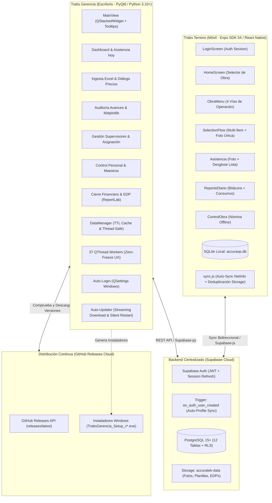
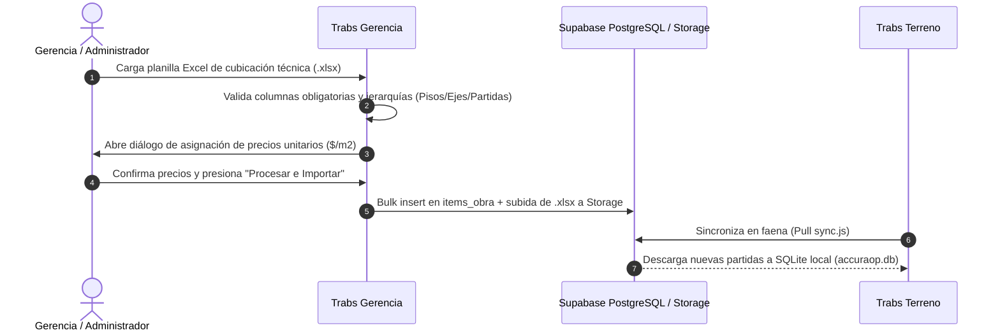
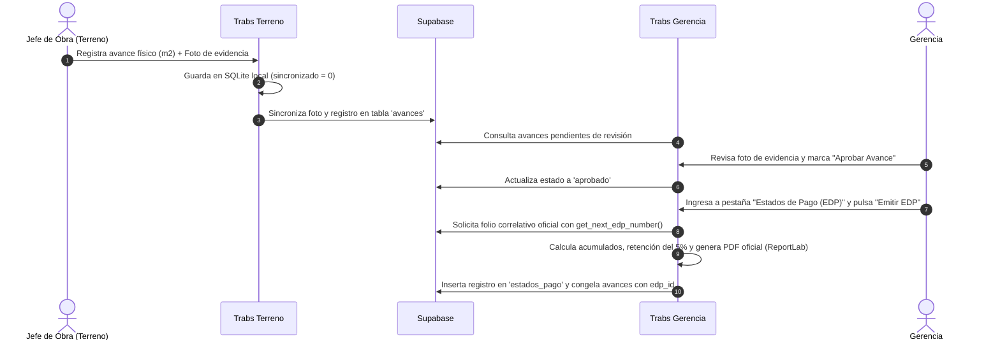

# 🏗️ Reporte de Arquitectura y Estado Actual: Ecosistema Trabs

**Organización**: Accuratek  
**Fecha de Actualización**: Agosto 2026  
**Estado del Proyecto**: Operativo en Producción E2E / Ingesta, Control de Personal, Asistencia, Avances, Bitácoras, Emisión Inmutable de EDP, Persistencia de Sesión y Auto-Actualizaciones Continuas (v1.0.5)  
**Autor**: Antigravity Coding Assistant & Accuratek Engineering Team  
**Documento**: Arquitectura Técnica Integral, Conectividad, Ecosistema Multiplataforma y Modelo de Datos

---

## 1. Resumen Ejecutivo del Sistema

El ecosistema **Trabs** (desarrollado por **Accuratek**) es una plataforma tecnológica integral multiplataforma diseñada para digitalizar, controlar y auditar en tiempo real la ejecución técnica, el capital humano y el cierre financiero de faenas de construcción especializada (protección pasiva de estructuras metálicas contra fuego mediante pinturas intumescentes, morteros ignífugos, aislaciones térmico-acústicas y sellos de pasadas).

El sistema opera sobre un backend en la nube basado en **Supabase** (PostgreSQL 15+, Auth y S3-compatible Storage) junto a un canal de distribución continua en **GitHub Releases**, articulándose en dos aplicaciones nativas con responsabilidades desacopladas:

1. **Trabs Gerencia (`accuraop_gerencia`)**: Aplicación de escritorio desarrollada en **Python 3.10+** y **PyQt6**. Diseñada para la alta dirección, administradores de contrato y gerencia operativa. Centraliza la ingesta masiva de cubicaciones desde planillas Excel, la administración de supervisores/jefes de obra con creación aislada en Auth y asignación matricial a faenas (`jefes_view.py`), la administración del catálogo maestro de materiales y personal (cargos, tarifas y maestros con tarjetas de perfil compactas y avatar antialiased), el monitoreo analítico en tiempo real con dashboards gráficos interactivos de **Matplotlib**, el módulo de **Ítems de Obra** con buscador instantáneo, filtros de estado y ficha técnica sincronizada por partida con histórico de avances, la auditoría visual de evidencias y la emisión inmutable de **Estados de Pago (EDP)** con compilación de PDF oficial mediante **ReportLab**. Cuenta con sistema de **Auto-Login persistente** (`QSettings`), motor de **Auto-Actualizaciones integradas** con GitHub Releases y empaquetado autónomo ejecutable para Windows (**Inno Setup v1.0.5**).
2. **Trabs Terreno (`accuraop_terreno`)**: Aplicación móvil desarrollada en **React Native** con **Expo SDK 54**. Diseñada para los Jefes de Obra y supervisores en el frente de faena. Opera bajo una arquitectura estricta **Offline-First** apoyada en una base de datos local **SQLite (`accuraop.db`)** y una caché reactiva en memoria (`memoryCache.js`). Permite registrar avances físicos por $m^2$ de forma individual o mediante **lotes multi-ítem con una sola foto de respaldo** (con subida deduplicada a Supabase Storage), tomar la asistencia diaria del personal asignado (con foto de grupo y soporte correctivo), redactar la bitácora diaria de incidentes/novedades y registrar el consumo diario de insumos. Cuenta con un pipeline de sincronización bidireccional en segundo plano (`sync.js`) y suite de pruebas automatizadas en 7 niveles.

---

## 2. Infraestructura y Seguridad en la Nube (Supabase)

Ambas aplicaciones se comunican con el backend de **Supabase** mediante sus SDKs oficiales (`supabase-py` para escritorio y `@supabase/supabase-js` para móvil).

### 2.1 Variables de Entorno y Conectividad
La configuración de endpoints y credenciales se gestiona de forma aislada mediante variables de entorno `.env`:

| Variable de Entorno | Tipo | Función en el Sistema |
| :--- | :--- | :--- |
| `SUPABASE_URL` | URL | Endpoint HTTPS del proyecto Supabase en la nube. |
| `SUPABASE_KEY` / `EXPO_PUBLIC_SUPABASE_ANON_KEY` | Public Key | Clave pública anónima (*Anon Key*) que opera sujeta a las directivas de seguridad RLS. |
| `GITHUB_TOKEN` | Secret Token | Token de acceso para automatizar la creación y subida de releases hacia GitHub desde la consola. |

### 2.2 Autenticación, Autorización y Persistencia
* **Supabase Auth**: Autenticación basada en correo y contraseña. Los tokens de acceso (JWT) y de refresco permiten mantener sesiones válidas.
* **Sincronización Automática de Perfiles (`on_auth_user_created`)**: Un disparador en PostgreSQL intercepta cualquier alta en `auth.users` y actualiza/inserta inmediatamente el registro correspondiente en `public.perfiles_usuario` (nombre, rol, email, teléfono, foto y rut).
* **Control de Roles por Aplicación**:
  * Rol `'administrador'`: Acceso total a la aplicación de escritorio (`accuraop_gerencia`) y permisos administrativos en la base de datos.
  * Rol `'jefe_obra'`: Acceso restringido exclusivamente a la aplicación móvil (`accuraop_terreno`). Si un usuario con rol `'jefe_obra'` intenta iniciar sesión en el escritorio, los hilos `LoginWorker` y `SessionCheckWorker` rechazan el acceso y cierran la sesión automáticamente.
* **Persistencia en Escritorio**: El `refresh_token` se almacena localmente en `QSettings` de Windows para restaurar la sesión automáticamente en el arranque sin pedir credenciales reiteradas.

### 2.3 Políticas de Seguridad a Nivel de Fila (RLS)
Todas las tablas del esquema PostgreSQL tienen activada la directiva **Row-Level Security (RLS)**:
* La función `public.es_administrador()` (`SECURITY DEFINER`) evalúa el rol administrativo sin provocar bucles de recursión infinita en las consultas sobre `perfiles_usuario`, normalizando con `TRIM(LOWER(rol))` para resistir inconsistencias de formato.
* Las políticas unificadas permiten operaciones fluidas de consulta, inserción y `.upsert()` para usuarios autenticados, manteniendo el filtrado contextual de obras asignadas (`obras_jefes_obra` y `obras_maestros`).

### 2.4 Almacenamiento Centralizado Unificado (`accuratek-data`)
El sistema utiliza el bucket público principal **`accuratek-data`** en Supabase Storage estructurado en subdirectorios temáticos:

| Subdirectorio en `accuratek-data` | Tipo de Contenido | Estructura de Rutas |
| :--- | :--- | :--- |
| `avances/` | Fotos de evidencia de avances físicos de obra | `avances/{jefe_obra_id}/{avance_id}.jpg` |
| `asistencia/` | Evidencias fotográficas de asistencia grupal | `asistencia/{jefe_obra_id}/{asistencia_id}.jpg` |
| `bitacora/` | Fotos de reportes de novedades e incidentes | `bitacora/{jefe_obra_id}/{reporte_id}_{idx}.jpg` |
| `personal/` | Fotos de perfil de trabajadores y personal | `personal/{uuid}.jpg` |
| `materiales/` | Catálogo de insumos: fotos y fichas técnicas | `materiales/fotos/{uuid}.jpg` / `materiales/fichas/{uuid}.pdf` |
| `edp/` | Documentos PDF oficiales de Estados de Pago emitidos | `edp/{obra_id}/{pdf_filename}.pdf` |
| `obras/` | Planillas Excel originales de cubicación | `obras/{obra_id}/{nombre_archivo}.xlsx` |

---

## 3. Arquitectura de Trabs Gerencia (`accuraop_gerencia`)

### 3.1 Patrón de Concurrencia Zero-Freeze (`core/workers.py` y `core/updater.py`)
Para garantizar una experiencia de usuario fluida e instantánea, toda interacción con la red, cálculos matemáticos pesados o compilación de documentos se delega a hilos `QThread`:
* **DataManager Singleton**: Mantiene una caché en memoria con TTL de 5 minutos, previniendo sobrecarga de consultas y aplicando reintentos automáticos ante bloqueos de socket en Windows (`WSAEWOULDBLOCK` / error `10035`).
* **Pull Inicial Masivo (`FetchInitialBatchWorker`)**: Descarga simultáneamente obras, supervisores, maestros, cargos y materiales al iniciar sesión.

### 3.2 Ciclo de Vida de Auto-Actualizaciones
1. **Detección**: Al arrancar la aplicación o presionar `"🔄 Buscar Actualizaciones"`, `CheckUpdateWorker` consulta `https://api.github.com/repos/pancholavinf/trabs-gerencia/releases/latest`.
2. **Comparación Semántica**: Compara la versión remota con la local mediante `packaging.version.parse`.
3. **Diálogo Interactivo**: Muestra `UpdateDialog` con las notas de la versión estilizadas en HTML.
4. **Descarga e Instalación**: `DownloadUpdateWorker` descarga el archivo `.exe` en `%TEMP%` con cálculo dinámico de velocidad en MB/s y ejecuta el instalador silencioso de Inno Setup (`/SILENT /CLOSEAPPLICATIONS`).

---

## 4. Arquitectura de Trabs Terreno (`accuraop_terreno`)

### 4.1 Principio Offline-First
La aplicación móvil opera de forma 100% independiente de la conectividad celular:
* **Base de Datos SQLite Local (`accuraop.db`)**: Réplica local con tablas `obras`, `items_obra`, `avances`, `asistencia`, `reportes_diarios`, `maestros` y `consumos_materiales`.
* **Caché en Memoria (`memoryCache.js`)**: Acelera la navegación instantánea en pantallas de selección.
* **Pipeline de Sincronización Bidireccional (`sync.js`)**:
  * **Pull**: Descarga las últimas cubicaciones y asignaciones desde Supabase al detectar conexión.
  * **Push**: Envía en lotes transaccionales los avances, fotos (vía `ArrayBuffer` en base64), asistencias y bitácoras pendientes (`sincronizado = 0`).

---

## 5. Resumen de Flujos E2E Clave del Ecosistema

### 5.1 Flujo de Ingesta y Cuadratura Técnica

### 5.2 Flujo de Avance Físico y Emisión Inmutable de EDP

