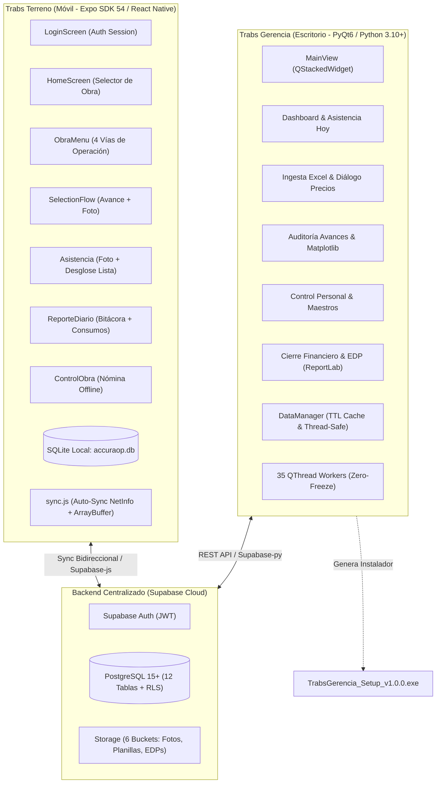
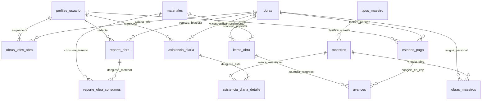
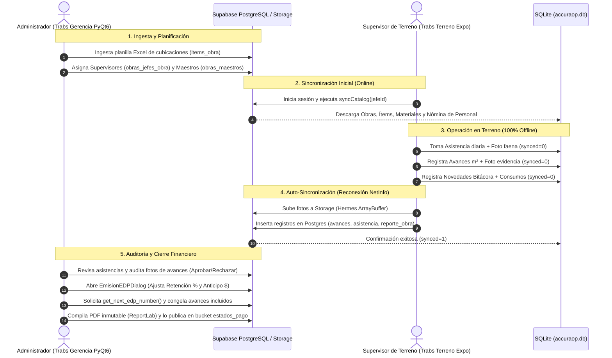

# 🏗️ Reporte de Arquitectura y Estado Actual: Ecosistema Trabs

**Organización**: Accuratek  
**Fecha de Actualización**: Agosto 2026  
**Estado del Proyecto**: Operativo en Producción E2E / Ingesta, Control de Personal, Asistencia, Avances, Bitácoras, Emisión Inmutable de EDP e Instalador Oficial v1.0.0  
**Autor**: Antigravity Coding Assistant & Accuratek Engineering Team  
**Documento**: Arquitectura Técnica Integral, Conectividad y Modelo de Datos (Supabase / Postgres / SQLite)

---

## 1. Resumen Ejecutivo del Sistema

El ecosistema **Trabs** (desarrollado por **Accuratek**) es una plataforma tecnológica integral multiplataforma diseñada para digitalizar, controlar y auditar en tiempo real la ejecución técnica, el capital humano y el cierre financiero de faenas de construcción especializada (protección pasiva de estructuras metálicas contra fuego mediante pinturas intumescentes, morteros ignífugos, aislaciones térmico-acústicas y sellos de pasadas).

El sistema opera sobre un backend en la nube basado en **Supabase** (PostgreSQL 15+, Auth y S3-compatible Storage) y se articula en dos aplicaciones nativas con responsabilidades desacopladas:

1. **Trabs Gerencia (`accuraop_gerencia`)**: Aplicación de escritorio desarrollada en **Python 3.10+** y **PyQt6**. Diseñada para la alta dirección, administradores de contrato y gerencia operativa. Centraliza la ingesta masiva de cubicaciones desde planillas Excel, la administración del catálogo maestro de materiales y personal (cargos, tarifas y maestros), el monitoreo analítico en tiempo real con dashboards gráficos interactivos de **Matplotlib**, la auditoría visual de avances con evidencia fotográfica y la emisión inmutable de **Estados de Pago (EDP)** con compilación de PDF oficial mediante **ReportLab**. Cuenta con empaquetado autónomo ejecutable e instalador de Windows (**Inno Setup v1.0.0**).
2. **Trabs Terreno (`accuraop_terreno`)**: Aplicación móvil desarrollada en **React Native** con **Expo SDK 54**. Diseñada para los Jefes de Obra y supervisores en el frente de faena. Opera bajo una arquitectura estricta **Offline-First** apoyada en una base de datos local **SQLite (`accuraop.db`)** y una caché reactiva en memoria (`memoryCache.js`). Permite registrar avances físicos por $m^2$ con captura obligatoria de fotos, tomar la asistencia diaria del personal asignado (con foto de grupo y soporte correctivo), redactar la bitácora diaria de incidentes/novedades y registrar el consumo diario de insumos. Cuenta con un pipeline de sincronización bidireccional en segundo plano (`sync.js`) y suite de pruebas automatizadas en 6 niveles.

---

## 2. Infraestructura y Seguridad en la Nube (Supabase)

Ambas aplicaciones se comunican con el backend de **Supabase** mediante sus SDKs oficiales (`supabase-py` para escritorio y `@supabase/supabase-js` para móvil).

### 2.1 Variables de Entorno y Conectividad
La configuración de endpoints y credenciales se gestiona de forma aislada mediante variables de entorno `.env`:

| Variable de Entorno | Tipo | Función en el Sistema |
| :--- | :--- | :--- |
| `SUPABASE_URL` | URL | Endpoint HTTPS del proyecto Supabase en la nube. |
| `SUPABASE_KEY` / `EXPO_PUBLIC_SUPABASE_ANON_KEY` | Public Key | Clave pública anónima (*Anon Key*) que opera sujeta a las directivas de seguridad RLS. |

### 2.2 Autenticación y Autorización
* **Supabase Auth**: Autenticación basada en correo y contraseña. Los tokens de acceso (JWT) y refresco se validan en cada arranque de aplicación.
* **Control de Roles por Aplicación**:
  * Rol `'administrador'`: Acceso total a la aplicación de escritorio (`accuraop_gerencia`) y permisos administrativos en la base de datos.
  * Rol `'jefe_obra'`: Acceso restringido exclusivamente a la aplicación móvil (`accuraop_terreno`). Si un usuario con rol `'jefe_obra'` intenta iniciar sesión en el escritorio, los hilos `LoginWorker` y `SessionCheckWorker` rechazan el acceso y cierran la sesión automáticamente.

### 2.3 Políticas de Seguridad a Nivel de Fila (RLS)
Todas las tablas del esquema PostgreSQL tienen activada la directiva **Row-Level Security (RLS)**:
* La función `public.es_administrador()` (`SECURITY DEFINER`) evalúa el rol administrativo sin provocar bucles de recursión infinita en las consultas sobre `perfiles_usuario`.
* Las políticas unificadas (actualizadas en la migración `002_fix_rls_jefes_obra.sql`) permiten operaciones fluidas de consulta, inserción y `.upsert()` para usuarios autenticados, manteniendo el filtrado contextual de obras asignadas (`obras_jefes_obra` y `obras_maestros`).

### 2.4 Almacenamiento Centralizado Unificado (`accuratek-data`)
El sistema utiliza el bucket público principal **`accuratek-data`** en Supabase Storage con políticas universales de lectura, escritura y actualización, estructurado en subdirectorios temáticos:

| Subdirectorio en `accuratek-data` | Tipo de Contenido | Estructura de Rutas |
| :--- | :--- | :--- |
| `avances/` | Fotos de evidencia de avances físicos de obra | `avances/{jefe_obra_id}/{avance_id}.jpg` |
| `asistencia/` | Evidencias fotográficas de asistencia grupal | `asistencia/{jefe_obra_id}/{asistencia_id}.jpg` |
| `bitacora/` | Fotos de reportes de novedades e incidentes | `bitacora/{jefe_obra_id}/{reporte_id}_{idx}.jpg` |
| `personal/` | Fotos de perfil de trabajadores y personal | `personal/{uuid}.jpg` |
| `materiales/` | Catálogo de insumos: fotos y fichas técnicas | `materiales/fotos/{uuid}.jpg` / `materiales/fichas/{uuid}.pdf` |
| `edp/` | Documentos PDF oficiales de Estados de Pago emitidos | `edp/{obra_id}/{pdf_filename}.pdf` |
| `obras/` | Planillas Excel originales de cubicación | `obras/{obra_id}/{nombre_archivo}.xlsx` |

---

## 3. Arquitectura de la Aplicación de Escritorio (`accuraop_gerencia`)

La suite de escritorio **Trabs Gerencia** es el centro de control operacional y financiero de Accuratek.

### 3.1 Patrón de Concurrencia Zero-Freeze (`core/workers.py`)
Para garantizar una experiencia visual 100% fluida, toda interacción I/O con Supabase (Postgres, Storage o ReportLab) se ejecuta en segundo plano sobre subprocesos `QThread`. El sistema cuenta con **35 clases de Worker especializadas**:

* **Autenticación y Sesión**: `LoginWorker`, `SessionCheckWorker`, `LogoutWorker`.
* **Carga de Catálogos y Pull Inicial**: `FetchInitialBatchWorker`, `FetchDashboardDataWorker`, `FetchJefesWorker`, `FetchObrasWorker`, `FetchObraDetailsWorker`.
* **Ingesta de Planillas**: `ProcessIngestaWorker` (parseo en DataFrame, limpieza, validación de tipos, respaldo en Storage e inserción masiva).
* **Gestión de Personal y Maestros**: `FetchTiposMaestroWorker`, `CreateTipoMaestroWorker`, `UpdateTipoMaestroWorker`, `DeleteTipoMaestroWorker`, `FetchMaestrosWorker`, `CreateMaestroWorker`, `UpdateMaestroWorker`, `DeleteMaestroWorker`, `AssignMaestroObraWorker`, `FetchMaestrosByObraWorker`, `UploadFotoPerfilWorker`.
* **Asistencia**: `FetchDashboardAsistenciaWorker`, `FetchAsistenciaReporteWorker`.
* **Materiales**: `FetchMaterialesWorker`, `SaveMaterialWorker`, `UploadMaterialFileWorker`, `DeleteMaterialWorker`.
* **Avances y Evidencias**: `UpdateAvanceStatusWorker`, `ImageDownloader` (descarga y escalado en caliente).
* **Estados de Pago (EDP)**: `FetchEDPHistorialWorker`, `EmitEDPWorker` (cálculo, obtención segura de folio con `get_next_edp_number`, renderizado PDF y congelamiento de avances).
* **Bitácora y Novedades**: `FetchReportesWorker`, `RespondReporteWorker`.

### 3.2 Capa de Gestión de Datos y Caché Reactivo (`core/data_manager.py`)
El módulo `DataManager` es un patrón **Singleton Thread-Safe** con control de concurrencia y tolerancia a fallos:
* **Caché TTL (Time-To-Live)**: Almacena en memoria consultas pesadas con una vigencia de 300 segundos, reduciendo drásticamente la latencia y el consumo de ancho de banda.
* **Manejo de Sockets en Windows**: El método `_safe_execute()` intercepta excepciones de red de bajo nivel (como `WSAEWOULDBLOCK` / error `10035`), aplicando reintentos automáticos progresivos con *backoff*.
* **Carga por Lotes Optimizada (`fetch_initial_batch`)**: Descarga en un único flujo Obras, Supervisores, Materiales, Cargos y Nómina de Maestros, reportando el progreso a la UI mediante señales (`pyqtSignal`).

### 3.3 Módulos de Interfaz de Usuario (`src/ui/`)
* **Navegación Unificada Monopágina (`main_view.py`)**: `QStackedWidget` con una barra lateral izquierda fija estilizada en Antracita Oscuro (`#2D3033`), conmutador de 5 vistas principales, botón de resincronización en caliente y botón de cierre de sesión.
* **Dashboard Principal (`dashboard_view.py`)**: 
  * Tarjetas KPI ejecutivas (*Presupuesto Contratado*, *Monto Aprobado*, *Monto en Revisión*).
  * Banner **📋 Asistencia Hoy**: Tarjeta de resumen con desglose de presentes, medios días, ausentes, % de presentismo y costo laboral del día.
  * Cuadrícula responsiva de 3 columnas con tarjetas de obra (`ClickableObraCard`) personalizadas con su color institucional.
* **Ingesta de Presupuestos (`ingesta_view.py` / `controller.py`)**:
  1. Carga del archivo Excel y extracción de la hoja `'CUBICACION'` (`skiprows=7`).
  2. Filtrado de filas nulas y normalización de las 25 columnas técnicas.
  3. Detección automática de insumos no catalogados mediante el asistente modal `CrearMaterialesNuevosDialog`.
  4. Asignación de Precios Unitarios de Contrato mediante `PreciosMaterialesDialog`.
  5. Bulk insert transaccional en `items_obra`, asociación en `obras_jefes_obra` y respaldo del archivo Excel en el bucket `archivos_obras`.
* **Detalle de Obra y Auditoría (`avances_window.py`)**:
  * Pestaña 1: **Estadísticas y Gráficos (Matplotlib)**: Progreso temporal acumulado (doble curva), gráfico de barras de avance por categoría (Ubicación / Estructura / Material) con switch Agrupado/Apilado, dona de distribución de estados de revisión y comparativa financiera.
  * Pestaña 2: **Auditoría de Avances**: Tabla de avances con buscador en tiempo real, filtros por supervisor y estado, visor lateral de fotos asíncrono y botones de Aprobación/Rechazo en 1 clic.
  * Pestaña 3: **Estados de Pago (`edp_tab.py`)**: Historial de folios emitidos, métricas de cobro, visor de PDF y diálogo modal de emisión oficial (`EmisionEDPDialog`).
  * Pestaña 4: **Bitácora y Novedades (`reportes_view.py`)**: Visualización del cuaderno diario de campo con visor de adjuntos.
* **Control de Personal y Maestros (`control_personal_view.py`)**: Módulo de administración CRUD de cargos (`tipos_maestro`), tarifas diarias, fichas de maestros con RUT/DNI, teléfono, foto de perfil y panel de asignación a faenas (`obras_maestros`).
* **Auditoría de Asistencia (`reportes_asistencia_view.py`)**: Filtros por obra y rango de fechas, visualización de foto grupal de terreno, desglose individual de asistencia y cálculo de costos diarios.
* **Catálogo Maestro de Materiales (`materiales_view.py`)**: Administración de recubrimientos, unidades de medida y rendimientos teóricos por $m^2$.

### 3.4 Motor de Generación de Estados de Pago PDF (`utils/pdf_edp_generator.py`)
El módulo compila documentos oficiales en PDF con formato corporativo de alta calidad técnica mediante **ReportLab**:
* Encabezado con logotipo corporativo y cuadro resumen de contrato.
* Tabla comparativa detallada de partidas: Cantidad Contratada, Cantidad Anterior Acumulada, Cantidad Presente del Período, Saldo por Ejecutar y Monto Presente ($).
* Liquidación financiera formal: Subtotal Bruto, Descuento Retención de Garantía (%), Amortización de Anticipo ($), Monto Neto Facturable, Impuesto al Valor Agregado (IVA 19%) y Total General.
* Cuadro de firmas reglamentarias (Jefe de Terreno, Administrador de Contrato e ITO / Cliente).
* Subida automática al bucket `estados_pago` y congelamiento inmutable de los avances vinculados (`estado_pago_id`).

### 3.5 Empaquetado e Instalador Oficial de Windows
* **PyInstaller (`gerencia.spec` & `build_exe.py`)**: Empaqueta la aplicación en modo `onedir` optimizado, incluyendo assets, fuentes, estilos QSS y dependencias compiladas.
* **Inno Setup (`TrabsGerencia_Setup.iss`)**: Compila el instalador nativo para Windows `dist_installer/TrabsGerencia_Setup_v1.0.0.exe` con accesos directos, icono de marca (`app_icon.ico`) y desinstalador integrado.

---

## 4. Arquitectura de la Aplicación Móvil (`accuraop_terreno`)

La aplicación móvil **Trabs Terreno** está construida en **React Native** con **Expo SDK 54** y diseñada para operar sin interrupciones en obras sin cobertura de red.

### 4.1 Base de Datos Local SQLite (`src/database/db.js`)
* La app mantiene una réplica local completa en **SQLite (`accuraop.db`)** con el mismo esquema relacional que Supabase PostgreSQL: `obras`, `obras_jefes_obra`, `items_obra`, `avances`, `tipos_maestro`, `maestros`, `obras_maestros`, `materiales`, `reporte_obra`, `reporte_obra_consumos`, `asistencia_diaria` y `asistencia_diaria_detalle`.
* Soporta transacciones atómicas (`BEGIN TRANSACTION / COMMIT / ROLLBACK`) para la ingesta del catálogo offline.
* Mantiene la bandera `synced` (`0 = pendiente de envío`, `1 = sincronizado con la nube`) en todas las tablas de captura local.

### 4.2 Pipeline de Sincronización Bidireccional (`src/database/sync.js`)
El motor de sincronización maneja dos direcciones de datos:

1. **Descarga del Catálogo (`syncCatalog(jefeId)`)**:
   * Descarga desde Supabase las obras asignadas al supervisor autenticado, sus ítems de cubicación, la lista de materiales globales, los cargos y los maestros asignados a sus faenas.
   * Actualiza atómicamente la base de datos SQLite y la caché reactiva en memoria (`memoryCache.js`).
2. **Subida y Procesamiento de Evidencias (Upload Pipeline)**:
   * **Monitoreo de Conectividad**: Utiliza `@react-native-community/netinfo`.
   * **Tratamiento Hermes ArrayBuffer**: Para evitar incompatibilidades en la subida de blobs en el motor Hermes de React Native, las fotos capturadas (`file://` o `content://`) se leen mediante `FileReader` nativo, se convierten a `ArrayBuffer` y se suben vía Supabase Storage a sus buckets correspondientes (`avance-fotos`, `asistencia-fotos`, `bitacora-fotos`).
   * **Sincronización por Módulos**:
     * `syncAvances()`: Sube fotografías de avance, inserta filas en `avances` y marca `synced = 1` con sello de tiempo del servidor.
     * `syncAsistencias()`: Sube foto de asistencia grupal, inserta cabecera en `asistencia_diaria` y el desglose en `asistencia_diaria_detalle`.
     * `syncReportes()`: Sube archivos adjuntos, inserta bitácoras en `reporte_obra` y consumos asociados en `reporte_obra_consumos`.
   * **Sincronización Automática en Segundo Plano (`startBackgroundSync`)**: Tarea periódica cada 60 segundos que evalúa conectividad y vacía las colas pendientes, notificando al usuario mediante toasts flotantes (`react-native-toast-message`).

### 4.3 Pantallas y Flujos de Usuario (`src/screens/`)
* **`LoginScreen.js`**: Inicio de sesión con Supabase Auth, validación de credenciales, persistencia de sesión y descarga automática del catálogo inicial.
* **`HomeScreen.js`**: Cabecera con datos del supervisor, indicador visual de sincronización (punto verde/ámbar/rojo) y lista de obras asignadas con tarjetas de borde cromático institucional.
* **`ObraMenuScreen.js`**: Menú central de la obra seleccionada con 4 vías de acción directa:
  1. **Registrar Avance (`SelectionFlowScreen`)**: Asistente modal en pasos: selección de elemento/plano, selección de estructura, ingreso numérico de $m^2$ ejecutados, captura de foto de evidencia con compresión (`imageCompressor.js`) y guardado local instantáneo.
  2. **Asistencia Diaria (`AsistenciaScreen`)**: Pase de lista diario de maestros asignados a la obra con selector de jornada (`Presente 1.0`, `Medio Día 0.5`, `Ausente 0.0`), captura obligatoria de foto grupal, observaciones y opción de reporte correctivo.
  3. **Bitácora y Consumos (`ReporteDiarioScreen`)**: Publicación de novedades/incidentes categorizados con fotos adjuntas y registro de materiales consumidos en el día.
  4. **Control de Obra (`ControlObraScreen`)**: Consulta offline de la nómina de personal asignado, sus cargos, teléfonos de contacto y RUT/DNI.

### 4.4 Infraestructura de Pruebas (Test Suite)
El proyecto móvil incluye una arquitectura de pruebas automatizadas dividida en 6 niveles:
* `tier1_feature.test.js`: Funcionalidad básica de pantallas y renderizado.
* `tier2_boundary.test.js`: Casos de borde (entradas nulas, strings gigantes, fallos de red).
* `tier3_integration.test.js`: Integración de navegación, SQLite local y auth.
* `tier4_workload.test.js`: Cargas masivas de ítems y maestros.
* `tier5_profile.test.js`: Actualización y persistencia de perfiles de usuario.
* `tier6_control_obra.test.js`: Pruebas de la nómina y consultas de personal en obra.

---

## 5. Matriz del Modelo de Datos (PostgreSQL en Supabase)

El esquema relacional centralizado en PostgreSQL consta de **12 tablas maestras**, **2 vistas analíticas**, **2 funciones en PL/pgSQL** y **5 migraciones cronológicas aplicadas**:

### 5.1 Catálogo Completo de Tablas del Esquema

1. **`perfiles_usuario`**: Usuarios de la plataforma vinculados a `auth.users(id)`. Columnas: `id` (UUID PK), `nombre`, `email` (Unique), `rol` (`'administrador'`, `'jefe_obra'`), `foto_perfil_url`, `clave`, `telefono`, `rut_dni`.
2. **`obras`**: Proyectos y faenas administradas. Columnas: `id` (UUID PK), `nombre`, `estado` (`'Activa'`, `'Pausada'`, `'Finalizada'`), `fecha_creacion` (timestamptz), `color` (HEX).
3. **`obras_jefes_obra`**: Relación M:N entre obras y Jefes de Obra. Columnas: `id` (UUID PK), `obra_id` (FK `obras`), `jefe_obra_id` (FK `perfiles_usuario`).
4. **`items_obra`**: Cubicaciones técnicas y presupuesto de contrato. Columnas: `id` (UUID PK), `obra_id` (FK `obras`), `ubicacion`, `plano`, `descripcion_plano`, `estructura`, `dimension`, `perfil`, `cantidad`, `cantidad_estructuras`, `largo_mm`, `caras_expuestas`, `perimetro_expuesto_mm`, `resist_fuego`, `masividad_m1`, `area_expuesta_m2`, `material`, `certificacion`, `micras`, `formula`, `tinetas`, `sacos`, `precio_unitario_contrato`, `material_id` (FK `materiales`), `anotaciones`.
5. **`avances`**: Registros cuantitativos de avance físico en $m^2$. Columnas: `id` (UUID PK), `item_obra_id` (FK `items_obra`), `jefe_obra_id` (FK `perfiles_usuario`), `estado_pago_id` (FK `estados_pago` Nullable), `foto_url`, `comentario`, `cantidad` (numeric $m^2$), `fecha_captura_local` (timestamp), `fecha_subida_servidor` (timestamp), `estado_revision` (`'pendiente'`, `'aprobado'`, `'rechazado'`).
6. **`estados_pago`**: Estados de Pago emitidos para cobro inmutable. Columnas: `id` (UUID PK), `obra_id` (FK `obras`), `numero_estado_pago` (int4 Unique por obra), `fecha_emision` (timestamptz), `periodo_desde` (date), `periodo_hasta` (date), `subtotal_pesos` (numeric), `monto_retencion` (numeric), `monto_anticipo` (numeric), `monto_neto` (numeric), `monto_iva` (numeric), `monto_total` (numeric), `orden_trabajo_num`, `archivo_pdf_url`, `creado_por` (FK `perfiles_usuario`), `observaciones`.
7. **`reporte_obra`**: Bitácora y cuaderno de novedades diario de terreno. Columnas: `id` (UUID PK), `obra_id` (FK `obras`), `jefe_obra_id` (FK `perfiles_usuario`), `tipo_reporte` (`'actualizacion'`, `'incidente'`, `'accidente'`, `'otro'`), `mensaje`, `archivos_adjuntos` (text[]), `fecha_publicacion` (timestamptz), `estado_reb` (`'pendiente'`, `'leido'`, `'respondido'`), `respuesta` (bool), `mensaje_respuesta`.
8. **`reporte_obra_consumos`**: Insumos consumidos en la jornada asociados a la bitácora. Columnas: `id` (UUID PK), `reporte_obra_id` (FK `reporte_obra`), `material_id` (FK `materiales` Nullable), `material`, `cantidad`, `unidad`, `fecha`.
9. **`materiales`**: Catálogo maestro de recubrimientos protectores. Columnas: `id` (UUID PK), `nombre` (text Unique), `unidad_medida` (`'tinetas'`, `'sacos'`, `'kg'`), `rendimiento_teorico_m2`, `descripcion`.
10. **`tipos_maestro`**: Catálogo de cargos/posiciones laborales y tarifas. Columnas: `id` (UUID PK), `nombre` (varchar Unique), `sueldo_diario` (numeric), `fecha_creacion`.
11. **`maestros`**: Fichas individuales de trabajadores de obra. Columnas: `id` (UUID PK), `nombre`, `rut_dni`, `tipo_maestro_id` (FK `tipos_maestro`), `telefono`, `foto_perfil_url`, `estado` (`'Activo'`, `'Inactivo'`), `fecha_creacion`.
12. **`obras_maestros`**: Asignación de trabajadores a faenas activas. Columnas: `obra_id` (FK `obras`), `maestro_id` (FK `maestros`), `fecha_asignacion`, `PRIMARY KEY (obra_id, maestro_id)`.
13. **`asistencia_diaria`**: Cabecera de toma de asistencia diaria con foto de faena. Columnas: `id` (UUID PK), `obra_id` (FK `obras`), `jefe_obra_id` (FK `perfiles_usuario`), `fecha` (date), `foto_url`, `es_correctivo` (boolean default false), `observaciones`, `fecha_registro`.
14. **`asistencia_diaria_detalle`**: Desglose individual de presentismo por trabajador. Columnas: `id` (UUID PK), `asistencia_id` (FK `asistencia_diaria`), `maestro_id` (FK `maestros`), `estado` (`'presente'`, `'medio_dia'`, `'ausente'`), `valor_jornada` (`1.0`, `0.5`, `0.0`), `observacion`, `UNIQUE (asistencia_id, maestro_id)`.

### 5.2 Vistas Analíticas y Procedimientos Almacenados
* **`v_asistencia_resumen`**: Vista consolidada que vincula cabeceras, detalles, cargos y calcula el costo diario devengado: $(\text{valor\_jornada} \times \text{sueldo\_diario})$.
* **`v_edp_resumen`**: Vista financiera desnormalizada que resume montos netos, IVA, retenciones y conteo total de avances incluidos por Estado de Pago.
* **`public.get_next_edp_number(p_obra_id UUID)`**: Función en PL/pgSQL con bloqueo `SHARE ROW EXCLUSIVE` que garantiza la generación secuencial y libre de colisiones del correlativo de EDP (1, 2, 3...) bajo concurrencia.
* **`public.es_administrador()`**: Función `SECURITY DEFINER` para evaluación segura de privilegios de usuario en políticas RLS.

---

## 6. Diagrama de Flujo Operativo E2E (End-to-End)

